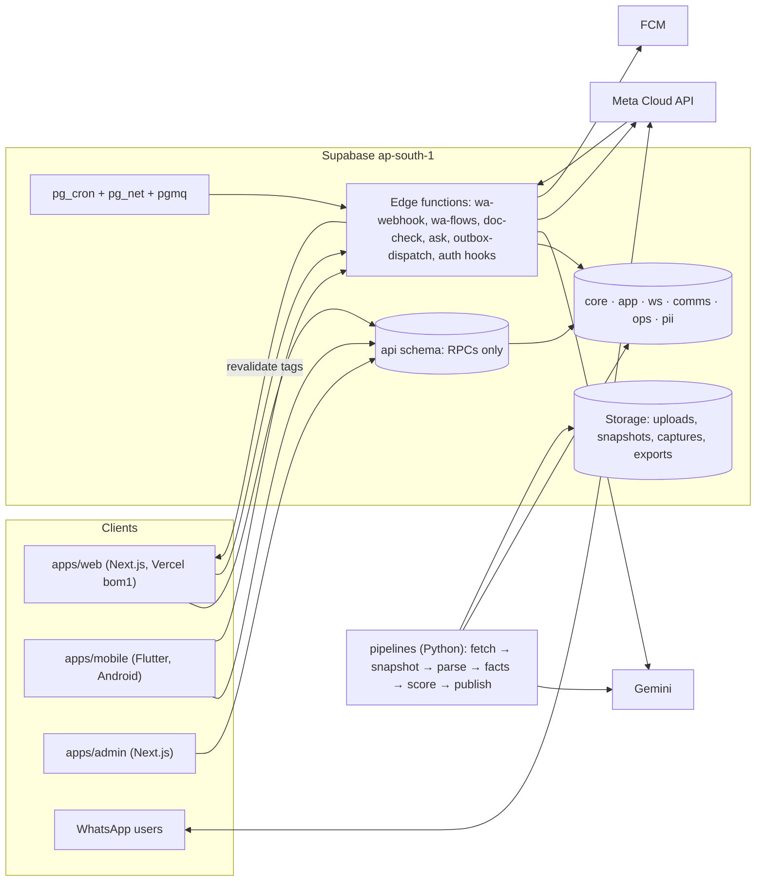

# Plinth R1 engineering build plan

Owner: Head of Engineering · Date: 19 Oct 2026 · Status: ready for the agent team
Companion docs: [DATA_MODEL.md](DATA_MODEL.md) · [API_CONTRACTS.md](API_CONTRACTS.md) · [WORK_BREAKDOWN.md](WORK_BREAKDOWN.md) · [SETUP_FOR_FOUNDER.md](SETUP_FOR_FOUNDER.md)
Sources: `product/PRD.md` (§6, §8, §12–§16, §20), `product/inputs/platform_architecture.md` (ADR-001 overrides §2.1 and §9 for mobile), `DESIGN.md` (§0–§5b), `reports/Developer and project risk scoring.md`, `product/design/review/*.md`, and the founder's Flutter app at `~/code/pet_app`.

---

## 1. How we build (eight rules every agent follows)

1. **Fixtures first.** DESIGN.md §5b is the seed dataset. Every surface runs end to end on it with no accounts and no network: web with `PLINTH_DATA=fixtures`, the app with `--dart-define=FIXTURES=true`, and the backend in CI on seeded Postgres. The clock is frozen at **18 Oct 2026, 12:00 IST** (design "today"; data as of 14 Oct 2026; model v1.2).
2. **One contract.** Clients call only the `api` schema (Postgres RPCs) and edge functions. JSON Schemas in `packages/contracts` generate TypeScript, Dart and Python types. The **RiskSummary** object is identical on web, app and WhatsApp.
3. **Rules run once, on the server.** Bands, reasons, natural frequencies, all-in cost, stamp duty, the 10% cap, payee checks, claim verdicts and every display string ("₹2.74 Cr all-in", "14 complaints · 2.8 per 100 units") come from the server. Clients only lay them out. The one exception is a slider preview port (EMI, Afford the wait), tested against the same golden vectors as the server.
4. **AI reads; rules decide.** LLMs extract and phrase. They never set a band, a verdict or a number. Every AI sentence carries a citation, or it is not shown.
5. **Consent is a database constraint.** A buyer's number reaches a party only through a row the buyer's own tap created. Triggers and pgTAP tests enforce this: "never shared without your tap".
6. **Exclusive file ownership.** Each task in WORK_BREAKDOWN.md owns its paths. Two parallel agents never edit the same file. Dependencies are frozen after T00; only the integrator adds one.
7. **Boring tech, pinned.** Supabase, Next.js, Flutter, Python. No Kubernetes, no Redis, no search cluster, no second backend language.
8. **No scraping before the legal memo.** The HARERA pipeline is built and tested on saved fixture HTML/PDF/JSON only. Live fetch is behind two keys: the `harera_live_fetch` flag *and* `HARERA_LIVE_FETCH_APPROVED=yes`.

---

## 2. R1 scope in one table

R1 runs about **26 weeks** (PRD D14). Gurugram only (D2). Web, Android and WhatsApp ship together (D3). No developer money (D1). Loans are R2. iOS is R2.

| Pillar | R1 features (PRD IDs) | Web | App | WhatsApp |
|---|---|---|---|---|
| Know the builder | F-01 truth panel, F-02 Delivery Risk card, F-03 developer page, F-04 compare, F-05 share card, F-06 evidence drawer, F-07 methodology, F-08 RERA/broker check, F-96 hard states, F-97 homes + "From the developer" | WebProject, WebProjectStates, WebDeveloper, WebCompare, WebMethodology, WebAbout, WebPricing, WebBrokerCheck | AppProject, AppProjectStates, AppRisk | WaRisk |
| Know the cost | F-10 cost-sheet normaliser, F-11 true cost, F-12/F-95 Afford the wait, F-94 Before you pay, F-92 Pay-as-built | WebCostSheet, WebBeforePay, WebPayAsBuilt | AppCostSheet, AppBeforePay, AppPayAsBuilt | WaCost, WaBeforePay |
| Claims and visits | F-90 Claims vs records, F-91 site-visit co-pilot, F-44 visit booking | WebClaims | AppClaims, AppScan, AppVisitPass | WaClaims, WaVisitPass |
| Stay protected | F-50 follow and alerts, F-93 Since you last looked, F-98 family circle | WebFollowing | AppFollowing, AppFamily | WaAlerts, WaDigest |
| Discovery and AI | F-30 Ask Plinth, F-31 search, F-32/F-33 discovery and SEO, F-34 dictionary, F-24a Visualise beta | WebHome, WebSearch, WebVisualise | AppExplore, AppMap, AppVoice, AppVisualiseCapture/Result | text and voice-note answers |
| Accounts and privacy | F-80 consent ledger + capped routing, F-81 privacy centre, F-84 grievance desk, F-85 RERA disclosure, F-89 dark-pattern checks | WebSignIn, WebPrivacy | AppOnboarding, AppYou | login code (auth template) |
| Developers (free, D12) | F-63+ workspace: claim, inbox, Live Record, facts editor, three lanes, notices, signals, legal intake | WebDevOnboarding, WebDevPortal, WebDevInbox, WebDevLiveRecord, WebDevFacts, `/capture` (AppDevCapture is phone web) | — | WaDevAlerts |
| Agents (thin layer, F-66a) | "For agents", HARERA agent check, agent of record, introductions logged. **No broker money in R1** (split rules v1 are a draft) | WebForAgents, WebAgentProfile, WebBrokerCheck | — | WaAgentOnboarding |
| Ops | F-86 admin: review queues, publishing gates, notices, disputes, WhatsApp inbox | `apps/admin` | — | — |

---

## 3. Milestones M0–M6

Week 1 starts **Mon 19 Oct 2026**. Agent throughput can compress M1–M5. External gates cannot be compressed: Meta business verification, TRAI DLT, the Play Console organisation account, the legal memo and the HARERA permission letter. Start those this week (SETUP_FOR_FOUNDER.md).

| M | Weeks (dates) | Theme | Scope |
|---|---|---|---|
| **M0** | W1 (19–25 Oct) | Foundations | Monorepo, tokens, contracts, core schema + RLS, §5b seed, CI, fixture-mode skeletons of web and app |
| **M1** | W2–W5 (26 Oct–29 Nov) | Know the builder (read path) | Read API (`risk_summary`, `project_page`, `developer_page`, `search_projects`, `compare`, `evidence`, `methodology`). Python scoring v1.2 reproducing §5b. HARERA parsers on fixtures. Web: Home, Search, Project + States, Developer, Compare, Methodology, About, Pricing. App: Explore, Map, Project + States, Risk. Share cards, SEO plumbing |
| **M2** | W5–W9 (23 Nov–27 Dec) | Accounts, follow, alerts, privacy | Phone-OTP auth, one account across web, app and WhatsApp. Follows and alert prefs. Event engine and Since you last looked. Outbox + notify router (push, WhatsApp, email). WhatsApp webhook with WaRisk, WaAlerts and WaDigest. Family circle (JOIN code). Consent ledger, Who has my number, export and delete. Admin shell |
| **M3** | W9–W13 (21 Dec–24 Jan) | Money and claims checks | One `doc-check` pipeline (OCR → two readers → rules) for Claims, Cost sheet, Pay-as-built and Before you pay, on web, app and WhatsApp. Cost rules v2026.10 in SQL. Afford the wait. Admin concierge queue for low-confidence reads |
| **M4** | W12–W16 (11 Jan–14 Feb) | Developer workspace and due process | Claim and verify, inbox and site check-in, Live Record `/r/` links and scan counts, facts editor, three lanes (CL-/D-/EV-), 7-day notice and 48-hour heads-up workflow, developer replies, facts-only mode, buyer signals (k ≥ 20), phone capture, WaDevAlerts, legal intake (LN-) |
| **M5** | W15–W20 (1 Feb–14 Mar) | Visits, agents, Ask Plinth, camera | Visit booking (WhatsApp Flow, web, app), visit pass with 5 questions, recap check, agent of record, the thin broker layer, Ask Plinth (text and voice), AppScan (QR, Where am I?, claims camera), Visualise beta with labels and C2PA |
| **M6** | W19–W26 (1 Mar–25 Apr 2027) | Real data, hardening, launch | Legal memo → live HARERA fetch from an Indian IP, backfill, entity resolution, first real calibration. S1 truth panel public, then the S2 bands gate. Performance, security and DPDP review. Templates approved. Play production. Runbooks. **Public launch target: week of 19 Apr 2027** |

**Fast path.** If the legal memo lands by W4, pull M6's data track into M2–M3. It is independent of the UI work, and PRD §15 wants S1 SEO pages live around week 6.

### Exit criteria (each must be demonstrable in CI or on the dev environment)

**M0: Foundations**
- `npm ci && npm run verify` passes locally (minus the Docker-only DB job) and in CI on `main`.
- Tokens and contracts regenerate with zero diff. A parity test shows identical hex values in `tokens.css` and the Dart `PlinthTokens`.
- The CI DB job applies every migration plus the §5b seed to Supabase Postgres 17 and passes pgTAP. That covers deny-by-default (anon can select no table), seed counts, and Aurelia's 72/41/77 and its band history (Moderate until 2 Oct 2026, then Elevated).
- Every JSON in `packages/fixtures/expected/` validates against its schema.
- In fixture mode, web renders `/gurugram/projects/aurelia-heights-phase-2` with the borderless Elevated chip from the expected RiskSummary. The app, in FIXTURES mode, opens on Explore with the seeded phases.
- `OWNERSHIP.md`, `AGENTS.md` and branch protection are in place.

**M1: Know the builder**
- For all 8 seeded phases, `api.risk_summary(slug)` deep-equals `packages/fixtures/expected/risk_summary/<slug>.json` under the frozen clock. The same holds for `project_page`, `developer_page`, `search_projects` and `compare`.
- Python scoring reproduces every §5b band, confidence, frequency, Late12 line, top-4 reason text and band-history row, plus the pending Elevated → High proposal (see §7.1).
- The HARERA parsers' golden tests pass on synthetic fixtures. Snapshots are immutable (pgTAP).
- The listed web pages and app screens are built. Flutter goldens are committed. The Playwright smoke passes. The project page ships ≤ 150 KB JS (gzip) and Lighthouse CI LCP ≤ 2.5 s on the throttled-4G preset.
- With `bands_public = false`, the server omits band, frequency and reasons (S1 truth panel), and both clients render the S1 state.

**M2: Accounts, follow, alerts**
- Phone OTP sign-in works on web and app, using Supabase test numbers in dev. WhatsApp follows merge only after "Bring them here".
- Rohan's seed reproduces §5b on every surface: 4 follows, last look 14 Oct 08:40, **5 unread changes**, weekly digest **Sundays 9 am** (next Sun 25 Oct), Meera in his circle, her father invited via `AH2-7KQ`.
- Advancing the clock to 25 Oct with the Jul–Sep QPR still missing publishes Elevated → High. The fan-out follows the ladder: developer notice already sent 18 Oct → followers get push, then WhatsApp template (mock Meta), within quiet hours and opt-ins. All of it is checked in pgTAP and Deno tests.
- "JOIN AH2-7KQ" from a new WhatsApp contact creates a member. pgTAP proves a circle member can never read cost sheets, visit passes, payment alerts, follow type or consents.
- Who has my number shows **3 parties can reach you** for Rohan with the five C-MMDD-NN rows. Withdrawing C-1012-04 ends Orbis's access, and the workspace masks the number at once.
- WaRisk, WaAlerts (band change, login code) and WaDigest pass recorded-payload tests. Cards render at 1080×1350 and 1080×570.
- Data export (ZIP: PDF + JSON) and account deletion work end to end.

**M3: Money and claims checks**
- The flyer gives **"4 of 7 claims differ"** and the hoarding **"1 of 3"**, with the exact §5b rows.
- The cost sheet gives ₹2.74 Cr and ₹18,900/sq ft carpet. Waiving PLC and club saves ₹4.9 L.
- Kavya's demand letter: stage *Can't check yet* (slab 12 vs slab 9), with plan, amount and payee matching.
- Payee check: the WhatsApp request matches 0 of 3, the booking form 3 of 3. The 10% cap is ₹24.4 L.
- Afford the wait reproduces ₹1,18,077 / ₹2,00,563 / ₹24.1 L / ₹48.1 L / ₹1,90,227.
- Zero false "Differs" on the fixture set. Recorded AI only in CI. Low-confidence rows land in the admin queue.

**M4: Developer workspace**
- Ashgrove's claim walks through the three signatory checks. Northfield's inbox shows the 7 §5b records. Check-in code 4821 finds Rohan.
- Placements AH2-H1, AH2-B3 and AH2-W count 214, 61 and 138 scans.
- The facts editor recomputes ₹2.74 Cr. CL-202 flows through the 2-day lane.
- The 7-day notice and 48-hour heads-up timers are correct. Facts-only mode withholds band, reasons and "of 100" everywhere, including search and compare.
- Signals suppress counts under 20. Capture links expire in 24 h, and raw GPS is never stored.

**M5: Visits, agents, AI**
- Rohan's pass shows code 4821 and the 5 questions, 2 of them sent ahead. The recap gives "1 of 5 differs".
- Agent of record (Larkspur) and the ≤ 3 cap are enforced. No broker money flows.
- The Ask Plinth eval set passes its groundedness and refusal gates. All four edge answers are templated. QR, Where am I? and the claims camera work on a mid-range Android phone. Every staged image carries a burned label and C2PA.

**M6: Launch**
- Live HARERA runs from an Indian IP: ≥ 250 Gurugram projects ingested with QPR history (PRD R0 exit), at most one request in flight per host, permission letter on file.
- The S1 gate (methodology v0.9 published, evidence vault live, 14-day developer notice delivered) is passed. The S2 gate is passed or consciously deferred.
- Security review and RLS audit are clean. The DPDP review is done. WhatsApp templates are approved. The Play production release is live.
- p75 LCP ≤ 2.5 s. Error budget is green for 14 days. Breach, takedown and portal-change runbooks are drilled once.

---

## 4. Repository layout

The repo root is `/Users/macbook/code/Real Estate` (remote `github.com/gauravmittal1234/plinth`, private). Existing `reports/`, `product/`, `research_notes/`, `scripts/` and `DESIGN.md` stay as they are.

```text
/
├── AGENTS.md                 rules for coding agents (ownership, commands, copy bans, no secrets)
├── OWNERSHIP.md              path → task map, generated from WORK_BREAKDOWN.md
├── DESIGN.md  PRD lives in product/   reports/  research_notes/  scripts/
├── apps/
│   ├── web/                  Next.js App Router: public SEO pages, buyer web, /workspace, /agents, /capture, /cards
│   ├── admin/                Next.js: review queues, publishing gates, notices, disputes, WA inbox, ops
│   └── mobile/               Flutter (Android first; iOS R2)
├── packages/
│   ├── tokens/               tokens.json → dist/tokens.css (+ Tailwind @theme), dist/tokens.ts, dart/ (plinth_tokens)
│   ├── contracts/            schemas/ (JSON Schema 2020-12), openapi/plinth.yaml, catalogues/ (flags, events,
│   │                         reason codes, WA templates, AI tasks, purposes, ref formats) → gen/ts, dart/ (plinth_contracts), python/
│   ├── fixtures/             canonical/ (§5b as JSON), expected/ (golden API outputs), vectors/ (calculator + format),
│   │                         media/, recorded/ (AI + Meta payloads), seedmap/ → supabase/seed/*.sql
│   ├── web-ui/               React components shared by web + admin (RiskChip, BandMeter, IconArray, EvidenceDrawer…)
│   ├── calc/                 TS slider-preview ports (EMI, Afford the wait), vector-tested (M3)
│   └── config/               tsconfig, eslint, prettier presets
├── supabase/
│   ├── config.toml           api schema exposed; auth phone + test OTPs; hooks
│   ├── migrations/           SQL: schemas, tables, RLS, api functions (timestamp ranges per task)
│   ├── seed/                 generated from packages/fixtures (never hand-edited)
│   ├── tests/                pgTAP: rls/, api/, rules/, seed/ ; shim/ + pglite runner for local checks
│   └── functions/            Deno edge functions + _shared/{core,ai,wa,outbox,docs}
├── pipelines/                Python: plinth/{core,sources/harera,extract,resolve,scoring,publish}, tests/fixtures
├── evals/                    AI golden sets + runners (ask, claims, extraction)
├── docs/                     engineering/ (these), adr/, runbooks/ (breach, takedown, portal-change, notice)
├── .github/workflows/        one workflow file per area (exclusive ownership)
└── package.json (npm workspaces) · turbo.json · .nvmrc · .env.example · .editorconfig
```

**House rules:**
- Apps never import from other apps.
- Generated files are committed, and CI fails on drift.
- Every table ships with RLS and a pgTAP test.
- Every AI task ships with an eval and recorded fixtures.
- Every data source ships with recorded fixtures.
- Every screen ships with a fixture-mode test (web: Playwright or Vitest; app: widget + golden).

**Design artboards.** The current canvas lives in this session's scratchpad (`/private/tmp/…/scratchpad/canvas/project/`), which is ephemeral. **T00 copies all `*.dc.html` + `canvas.json` into `product/design/artboards/`** before anyone codes. Three artboards are not drawn yet: AppCostSheet, AppPayAsBuilt and WaBeforePay (all M3).

---

## 5. Tech choices, with versions

Pin exact patch versions at T00 and record them in the lockfiles. The versions below are the floors we design against.

### 5.1 Shared toolchain

| Tool | Version | Decision |
|---|---|---|
| Node.js | **22 LTS** in CI and Vercel; local 20.20.2 works (`engines: ">=20.19"`) | Node 20 left LTS in Apr 2026, so CI and production use 22. The founder should move local to 22 when convenient |
| Package manager | npm 10 **workspaces** + Turborepo ^2 | No pnpm, so nothing to install. One root `package-lock.json`, frozen after T00 |
| TypeScript | ^5.9, `strict`, `noUncheckedIndexedAccess` | |
| Supabase | CLI **2.118** (CI uses `supabase/setup-cli`); Postgres **17** with PostGIS 3.5, pgvector 0.8, pg_trgm, pgcrypto, pg_cron, pg_net, pgmq, pgTAP | One backend (ADR-001) |
| Edge runtime | Supabase Edge Runtime (Deno 2). Local tests via `npx --yes deno@2 test` (no install) | |
| Python | **3.14** locally and in CI. `pyproject.toml` (hatchling) + `uv.lock`. CI uses `astral-sh/setup-uv`; locally `pip install -e "pipelines[dev]"` also works (uv isn't installed) | |
| Flutter / Dart | **3.47.5 / 3.13.4** (as installed; matches pet_app's `sdk: ^3.13.4`) | |
| Contracts codegen | json-schema-to-typescript ^15 · quicktype ^23 (Dart, null-safe) · datamodel-code-generator (Pydantic v2) · ajv ^8 | JSON Schema is the source of truth |
| Tokens | style-dictionary ^4 with custom formats (CSS vars + Tailwind v4 `@theme`, TS, Dart ThemeExtension) | |
| Local DB check (no Docker) | @electric-sql/pglite ^0.3 with `vector` and `pg_trgm`, plus a Supabase shim (`auth.uid()`, roles, `auth.users`) | Fast syntax and RLS-lite check. CI is authoritative (§8) |

### 5.2 Web (`apps/web`) and admin (`apps/admin`)

| Concern | Choice |
|---|---|
| Framework | **Next.js ^16.4** App Router + React 19 (its peer). RSC by default. ISR with tag revalidation (`phase:<slug>`, `developer:<slug>`, `search`) on score publish |
| Styling | **Tailwind CSS ^4**, fed only by `@plinth/tokens/css`. No hard-coded colours (lint rule). Bricolage Grotesque 800 + Mukta via `next/font/google` |
| Primitives | Radix UI (Dialog/Sheet, Tabs, Popover, Slider, Switch) for accessibility. All visuals are our own, per DESIGN §0 (no glass, no glow, no resting shadows) |
| Data | `@supabase/supabase-js` ^2 + `@supabase/ssr` (cookie sessions). Server components call `api.*` RPCs with the publishable key. Account pages use the user's JWT. `ajv` validates responses against contract schemas in dev and test |
| Maps | **maplibre-gl ^5 + pmtiles ^4**. A Protomaps Gurugram extract is served from Supabase Storage. In fixture mode the map has no basemap: background + project pins |
| Cards | `next/og` (Satori) at `/cards/{risk,cost,visit,digest,changed}/…png` (1080×1350, 1080×570). WhatsApp fetches these URLs |
| Instruments | Riskometer, icon array, 3D tower (CSS 3D), replay, Afford-the-wait chart: hand-built SVG/CSS per the artboards. No chart library. Motion is CSS only, with `prefers-reduced-motion` |
| Tests | Vitest ^3 + Testing Library · Playwright ^1 + @axe-core/playwright · @lhci/cli budgets |
| Lint | ESLint 9 flat (`next/core-web-vitals`) + Prettier 3 + a banned-copy lint (§12.3) |
| Admin extras | TanStack Table ^8. Admin is a separate Vercel project and domain, behind email OTP + TOTP MFA (`aal2`) |
| Hosting | Vercel, functions pinned to **bom1** (Mumbai) |

### 5.3 Mobile (`apps/mobile`): reusing pet_app's proven patterns

| pet_app pattern (file) | Plinth use |
|---|---|
| **flutter_riverpod ^3.4.3**, plain `Provider`/`FutureProvider`/`Notifier`, no codegen (`lib/data/session.dart`) | Same. One provider file per domain under `lib/data/` |
| **go_router ^18.0.2** behind a `routerProvider` with `refreshListenable` tied to auth (`lib/app.dart`) | Same, but browsing never redirects to sign-in. Only `/you/*` and account actions open the sign-in sheet. Routes mirror web paths, so Android App Links open the same URL |
| `Supabase.initialize(url, publishableKey)` in `main.dart`; `Env` via `String.fromEnvironment` (`core/config/env.dart`) | Same, but **no hard-coded defaults**: an empty URL means FIXTURES mode |
| `UncontrolledProviderScope` + `kDemoMode` provider overrides (`demo/demo_mode.dart`) | `kFixtures` overrides swap every repository for one reading the bundled `packages/fixtures/expected` JSON |
| Folders `lib/core/{config,theme,widgets}`, `lib/data/*`, `lib/features/<feature>/*_screen.dart`, flat `test/` | Same structure, but tests mirror features (`test/features/<f>/`) so parallel agents don't collide |
| `SyncQueue` offline replay in shared_preferences (`data/sync_queue.dart`) | Follow/unfollow, alert prefs and notes queue offline and replay on resume and every 20 s |
| Push: firebase_messaging + Crashlytics, wrapped so the app always opens (`features/reminders/push.dart`); FCM HTTP v1 sender (`supabase/functions/_shared/fcm.ts`) | Copied, with data-only messages carrying a deep link |
| Bundled fonts for an offline first launch | Bricolage Grotesque + Mukta (plus a Noto Sans fallback) bundled |
| share_handler (share sheet in), google_mlkit_document_scanner, image_picker, flutter_image_compress, speech_to_text **7.6.0-beta.4 (keep pin and reason)**, flutter_tts, geolocator, permission_handler, share_plus, url_launcher, package_info_plus, flutter_svg, flutter_animate, intl, uuid | All reused: Claims via share sheet, cost-sheet and flyer capture, voice, Where am I?, sharing cards |
| Edge-function style: pure `logic.ts` + `logic.test.ts` (Deno), a header comment stating the contract, `_shared/` modules | Same |
| SQL smoke as a `DO` block that raises at the end, so it rolls back on a hosted DB (`supabase/tests/smoke_core_schema.sql`) | Same, for hosted `plinth-dev` checks without Docker |
| `delete-account` edge function; secret patterns in `.gitignore` | Same |

**Not reused:**
- **drift**: R1 caches API payloads as JSON files, which is simpler.
- **google_sign_in**: phone OTP in R1; Google sign-in for NRIs later.
- **google_maps_flutter**: we use **maplibre_gl** (Flutter) on the same PMTiles and style as the web. That means one map stack and no Google billing account. T30 verifies PMTiles support; if it falls short, we pre-extract z/x/y tiles to Storage.
- **New packages:** mobile_scanner (RERA QR) and google_mlkit_text_recognition (on-device pre-OCR).
- **Targets:** Android minSdk 24, targetSdk 36. Build size ≤ 25 MB (split per ABI). Cold start < 3 s on a 3–4 GB phone.

### 5.4 Backend, pipelines and AI

| Part | Choice |
|---|---|
| Database | Supabase Postgres 17. Private schemas `core`, `app`, `ws`, `comms`, `ops`, `pii`; **only `api` is exposed** to PostgREST |
| Jobs | **pg_cron** (sub-minute schedules) + **pg_net**, which call edge functions with a Vault-stored dispatch secret (as pet_app's `push_dispatch`). **pgmq** queues hold doc-checks and fan-out. `EdgeRuntime.waitUntil` handles fast acks |
| Edge functions | Deno 2. `wa-webhook`, `wa-flows`, `outbox-dispatch`, `doc-check`, `ask`, `auth-sms-hook`, `retention-sweep`, `export-data`, `delete-account`, `capture`, `stage-room` (M5), `health` |
| Pipelines | Python 3.14: httpx ^0.28, lxml ^5, pdfplumber ^0.11, pydantic ^2, psycopg[binary] ^3.2, PyYAML, google-genai ^1. Tests: pytest ^8, hypothesis ^6. Lint: ruff + mypy (strict on `scoring/`). Splink and scikit-learn arrive in M6. They connect as a dedicated **`pipeline_writer`** Postgres role, never the service key |
| AI | **Gemini** behind one task-based gateway (§13), in TS (`supabase/functions/_shared/ai`) and Python (`pipelines/plinth/extract/gateway.py`). Model IDs are pinned per task in `packages/contracts/catalogues/ai_tasks.json` after a bake-off |
| Production hosting later | Cloud Run Jobs in asia-south1 for live fetches (Indian egress IP), from M6 |

---

## 6. Architecture in one picture



- **Read path.** A page calls `api.project_page('aurelia-heights-phase-2')`, which reads the published `core.score_runs` and facts and returns server-rendered strings. Web caches it with ISR. The app caches it as JSON for offline use.
- **Write path.** A buyer action calls an `api.*` RPC, a SECURITY DEFINER function with explicit checks, that writes `app.*` and the audit log. Side effects go to `comms.outbox`, and `outbox-dispatch` delivers them.
- **Score path.** The pipeline writes a draft run, `publish` decides between immediate publication, a 48-hour heads-up or a 7-day notice, then on publish it writes `core.events` → fan-out → revalidate.

---

## 7. Testing strategy

| Layer | Tool | What it proves | Runs |
|---|---|---|---|
| Unit (TS) | Vitest | Formatters, data adapters, components' state logic | Every PR (web, admin, packages) |
| Unit (Dart) | flutter_test | Repositories, view-model logic, formatters (vector-tested) | Every PR (mobile) |
| Unit (Deno) | `deno test` | Edge `logic.ts`: intent routing, HMAC, quiet hours, template rendering, the refusal classifier | Every PR (edge) |
| Unit (Python) | pytest + hypothesis | Parsers, validators, features, scorecard, monotonicity | Every PR (pipelines) |
| **DB / RLS** | **pgTAP** (`supabase test db`) | Deny-by-default; anon sees no table; every `api` function's grants; the consent invariants; the score firewall; snapshot immutability | Every PR touching `supabase/` |
| **Contract** | `packages/fixtures/scripts/api-contract-test.mjs` | On seeded CI Postgres with the frozen clock, every `api.*` read for every fixture key deep-equals `expected/…json` and validates against its schema | Every PR touching `supabase/`, `contracts/` or `fixtures/` |
| **Golden vectors** | Shared JSON in `fixtures/vectors/` | The same numbers from SQL (canonical), TS preview and Dart preview: EMI, Afford the wait, 10% cap, ₹ formatting ("₹2.74 Cr", "₹24.1 L", "₹1,67,20,000"), dates ("18 Oct 2026", "Apr–Jun 2026") | Every PR in each language |
| **Flutter goldens** | `matchesGoldenFile`, fonts loaded in `flutter_test_config.dart`, **generated on Linux CI only** (`--tags golden`; a `update-goldens` workflow_dispatch commits new ones) | Every App* screen in Day + Night and in each state (AppProjectStates × 7, AppRisk bands × 5) | Every PR (mobile) |
| **Playwright smoke** | Chromium, fixture build, plus an axe scan | Each Web* route renders its signature element. Key flows: follow (fixture auth), compare add/remove, evidence drawer, the band tweak via `?state=`. No serious a11y violations | Every PR (web); full suite nightly |
| Performance | Lighthouse CI | Project page ≤ 150 KB JS, LCP ≤ 2.5 s (throttled 4G), CLS < 0.1 | Every PR (web) |
| WhatsApp | Recorded Meta payloads → `wa-webhook` → snapshot of the Graph API request bodies | WaRisk, WaAlerts, WaDigest, JOIN and STOP behave as drawn; buttons ≤ 20 chars; ≤ 3 reply buttons | Every PR (edge) |
| AI evals | `evals/` runners with recorded responses in CI and live nightly when a key exists | Extraction precision/recall, false-Differs rate, groundedness, refusal accuracy | Recorded on PR, live nightly |
| Parsers | Golden tests on `pipelines/tests/fixtures/harera/` | Exact records out of each fixture, including the dirty cases (negative collections, "31/06") | Every PR (pipelines) |

### 7.1 Scoring tests that reproduce §5b (in `pipelines/tests/scoring/test_section5b.py`)

These run on the canonical facts with data cutoff 14 Oct 2026, model v1.2. They must pass before any band UI merges.

| Case | Expected |
|---|---|
| Aurelia Heights Ph 2 | **Elevated**. Confidence **low**: Northfield has 6 finished RERA projects, below the config threshold `confidence.min_finished: 8`. Frequency "Between **30 and 45** of 100". Icon array 30 filled + 15 hatched |
| Kestrel Park / Sapphire Grove Ph 1 | **Low** high ("About 10 of 100") / **Moderate** high ("About 20 of 100") |
| Coral Towers | **High**, low confidence. Stale flag: newest QPR (Jan–Mar 2026) is **187 days** old on 18 Oct, past the 120-day line |
| Laurel Residency | **Severe**, `set_by = red_flag_rule`, rule `RF1_GROUP_CIRP` (NCLT order 12 Mar 2023), no frequency shown. **Stall** flag: 34% in each of the 4 QPRs Jul–Sep 2025 to Apr–Jun 2026; 106% of time used |
| Juniper Enclave | **Limited history** (Halcyon Homes has < 3 finished projects). No penalty, no band |
| Heron Point Ph 2 | **Not scored**: registered < 6 months before the cutoff (fixture date 28 Apr 2026, to be added to §5b) |
| Cedar Walk Ph 2 | **Moderate** |
| Late12 line (Aurelia) | Dec 2027 + 4 months (MoHUA blanket, completions on/after 28 Feb 2026) + 12 months = **Apr 2029**. Never "Dec 2028" |
| Time used | Month-based: (months from registration to reference month) ÷ (months from registration to original completion). This gives Aurelia's 10/20/30/40/50/60/65/70 by quarter and **77%** on 18 Oct 2026 |
| Aurelia reasons, rank order, exact text | (1) Finances: "72% of units sold, 41% built." (2) Timeline: "77% of the promised time used. QPRs filed late in 3 of the last 8 quarters." (3) Legal: "14 complaints decided against the promoter in 24 months · 2.8 per 100 units. Median count for similar projects: 3." (4) Track record: "2 of the group's 6 finished RERA projects got OC more than 12 months late." Each has ≥ 1 fact id |
| Late filings | Jul–Sep 2024 (12 days), Jan–Mar 2025 (41), Oct–Dec 2025 (38). Apr–Jun 2026 filed 15 Jul, **on time** (D-118 upheld) |
| Band history | Moderate from first public scoring (15 Jul 2026, v1.0) → v1.1 run on 2 Oct gives **Elevated** (heads-up sent 30 Sep, 48 h earlier) → v1.2 recalculation on 14 Oct stays Elevated. No Elevated row before 2 Oct |
| Pending change | A run as of 25 Oct with the Jul–Sep QPR still missing proposes **High** → the 7-day notice dated 18 Oct is effective 25 Oct. If the QPR lands before 25 Oct, the proposal is withdrawn and Elevated stays. `api.risk_summary` never exposes "High" before publication |
| Re-scoring (Sapphire) | New QPR fetched 16 Oct 19:40 → state `rescoring` until **19 Oct 19:40** (72 h). It shows Moderate from Apr–Jun 2026 and no figures from the new filing |
| Complaint rate | 14 → 2.8 per 100 units (500). Group 24 → 0.7 per 100 units (3,400 units). Kestrel 2 → 0.5; Sapphire 5 → 1.4 |
| Calibration | The illustrative table (Low 9, Moderate 31, Elevated 38, High 56, Severe 74 per 100; base rate **36 of 100** = 76/212). Brier 0.19 vs 0.23 |
| Properties (hypothesis) | Widening sold − built never lowers the band. An extra late QPR never improves it. A red flag always gives Severe. Reasons ≤ 4. Every published reason cites a fact |

The v1.2 scorecard is **expert-set** (WoE bins + logistic coefficients in `pipelines/plinth/scoring/models/v1.2.yaml`), with category weights published at Finances 30 / Track record 30 / Timeline 20 / Legal 15 / Site 5. It is tuned so the fixtures land as above. Fitting on real HARERA outcomes is M6 work and needs the legal memo.

---

## 8. CI (GitHub Actions)

All jobs run on `ubuntu-latest`; no macOS runners are needed. Workflows are split by area so each has one owner. `dorny/paths-filter` gates them, and `concurrency: cancel-in-progress` stops superseded runs.

| Workflow | Owner task | Steps |
|---|---|---|
| `ci-guard.yml` | T00 | gitleaks. Grep guards: no `sb_secret_`/service key or `SUPABASE_SECRET` in `apps/`, no `.env*` committed, no banned copy in `apps/` strings. The OWNERSHIP check warns when a PR touches paths outside its task |
| `ci-tokens.yml` | T01 | Build tokens → `git diff --exit-code` → CSS/Dart parity test |
| `ci-contracts.yml` | T02 | ajv compiles every schema → codegen → diff check → `dart analyze packages/contracts/dart` → validate `fixtures/expected/**` |
| `ci-db.yml` | T04 | **`supabase db start` (Docker is available on GitHub runners)** → `supabase db reset` (migrations + seed) → `supabase test db` (pgTAP) → API contract tests with `plinth.fixed_now` → `supabase db lint --level error`. A fast PGlite job runs first |
| `ci-edge.yml` | T29 | `denoland/setup-deno@v2` → fmt, lint, check, test (recorded Meta and AI payloads) |
| `ci-web.yml` | T05 | Lint, typecheck, Vitest → `next build` (fixtures) → Playwright smoke + axe → Lighthouse CI budgets |
| `ci-admin.yml` | T54 | Lint, typecheck, Vitest, build |
| `ci-mobile.yml` | T06 | `subosito/flutter-action` (3.47.5) → `flutter analyze` → `flutter test` → goldens → `flutter build apk --debug --dart-define=FIXTURES=true`, uploaded as an **artifact the founder can sideload** |
| `ci-pipelines.yml` | T10 | setup-uv → ruff → mypy → pytest (parsers, scoring §5b) |
| `nightly.yml` | T00 | Full Playwright, live AI evals (only if `GEMINI_API_KEY` is set), `npm audit --omit=dev`, `flutter pub outdated`, synthetic health checks once dev exists |
| `deploy-dev.yml` | T00 (enabled when secrets exist) | `supabase link` → `db push` → `functions deploy` → reset seed (dev is the frozen fixture world). Vercel deploys through its Git integration |
| `release-android.yml` | M6 | On tag `mobile-v*`: signed AAB → Play internal track |

**Branching:** `main` is protected. One PR per task (`task/T05-web-skeleton`), squash merge. Required checks are `ci-guard` plus the area checks that ran.

**Minutes:** private repos get 2,000 free minutes a month, and a full PR run is about 20–25 minutes. Path filters keep a typical PR to 5–10 minutes. If agents open more than ~150 PRs a month, we need GitHub Team or a self-hosted runner on the founder's Mac (decision D-3).

---

## 9. Environments

| Env | Data | Backend | Web | App | AI | WhatsApp | Clock |
|---|---|---|---|---|---|---|---|
| **local** | `packages/fixtures` | None, or PGlite for DB checks | `PLINTH_DATA=fixtures npm run dev -w @plinth/web` | `flutter run --dart-define=FIXTURES=true` | Recorded | Mock | Frozen 18 Oct 2026 12:00 IST |
| **ci** | Seed | Supabase Postgres in Docker on the runner | Fixture build + contract tests | Goldens, debug APK | Recorded | Mock | Frozen (`plinth.fixed_now`) |
| **dev** (hosted) | Seed: the "fixture world" | `plinth-dev` (Supabase free tier, Mumbai) | Vercel preview per PR + `dev` branch | Debug APK pointed at dev | Live Gemini (founder key, daily budget) or recorded | Meta **test number** (free, up to 5 recipients) | Frozen, because `plinth.env='fixture'` |
| **staging** (M6) | Real HARERA (after the memo) | `plinth-staging` (Pro) | Vercel staging | Play internal track | Live, paid tier | Business number, test templates | Real |
| **prod** | Real | `plinth-prod` (Pro, ap-south-1; PITR when revenue starts) | Vercel Pro, bom1 | Play production | Live, paid tier / Vertex | Verified business number | Real |

**The clock.** All date logic in SQL calls `ops.now()`. It returns `current_setting('plinth.fixed_now')` only when the database setting `plinth.env` is `test` or `fixture`; otherwise it returns `now()`. Clients get "today" from the API's `meta.generated_at`, never from the device, for anything shown as a fact.

**Configuration.** Twelve-factor env vars, listed in `.env.example`. Secrets live in `.env.local` (gitignored), Vercel env, `supabase secrets set` and GitHub Actions secrets, never in chat or code. Public client config is limited to the Supabase URL and publishable key.

---

## 10. Feature flags

- **Store:** `ops.feature_flags` (key, enabled, rollout_pct, audience `anon|user|internal`, surfaces[], note). Clients read it through `api.flags()`, cached 60 s at the edge. The typed catalogue is `packages/contracts/catalogues/flags.json`. Adding a flag means a catalogue entry and a migration row.
- **Build-time modes** are not flags: `FIXTURES`/`PLINTH_DATA`, `AI_MODE=recorded|live`, `META_MODE=mock|live`, `PLINTH_FETCH_MODE=fixtures|live`.
- **Data states are not flags either.** Facts-only for a developer group, claimed or unclaimed, stale and re-scoring are data on the record.
- **R1 flags:**
  - `bands_public` (S1 → S2, enforced server-side: band fields are null when off)
  - `harera_live_fetch` (plus the env second key)
  - kill switches: `ai_ask`, `ai_doc_check`, `ai_staging`, `wa_outbound`, `wa_inbound`, `push_outbound`, `email_outbound`
  - `since_replay_slider` (fix-since-family says jump chips in R1, slider optional)
  - `family_circle`, `dev_workspace`, `visit_booking`, `broker_layer`, `buyer_signals`, `pro_paywall` (off until a payment partner exists), `map_tiles`
  - `facts_only_global` (the emergency switch for every page)
  - `maintenance_mode`
- **Experiments** (PostHog, later): one public price per period, never per visitor (WebPricing promise).

---

## 11. Observability

| Signal | Tool (free tier, no-op without a key) | Detail |
|---|---|---|
| Errors | Sentry: web, admin, edge, pipelines. Firebase Crashlytics: Android (reused from pet_app) | A release tag per deploy. PII scrubbing. User id as a salted hash |
| Logs | JSON lines: `level, msg, request_id, fn, user_hash, latency_ms` | `x-request-id` propagates web → edge → DB (`set_config('plinth.request_id')`) → `ops.audit_log` |
| Pipelines | `ops.job_runs` + `ops.source_freshness` view | Alert when parse yield moves > 20% or data is older than 1.5× its cadence (catches silent portal changes) |
| AI | `ops.ai_generations` (task@version, model, prompt version, input SHA, tokens, ₹ cost, latency, cited fact ids, refusal code) | Per-task daily budgets: alert at 80%, kill switch at 100% |
| Outbox | `comms.outbox` status counts, lag p95 | Admin `/ops` shows backlog, failures and mock deliveries (the "mail catcher") |
| Product analytics | PostHog, typed catalogue `catalogues/events.json` (`report_viewed`, `reason_expanded`, `evidence_opened`, `project_followed`, `whatsapp_optin_granted`, `search_submitted`, `claims_checked`, `answer_feedback`, `consent_granted`, `number_shared`…) | Only under analytics consent. Pseudonymous ids. No session replay on account pages |
| Uptime | `nightly.yml` + a 15-minute synthetic check (web `/api/health`, edge `health`, WhatsApp webhook verify) once dev exists | |

**SLOs (from M6):** project page p75 LCP ≤ 2.5 s · `api` read p95 ≤ 300 ms · WhatsApp webhook ack p95 ≤ 2 s · outbox lag p95 ≤ 2 min · re-score ≤ 72 h after a new filing · doc-check result ≤ 30 s on web and ≤ 60 s on WhatsApp.

---

## 12. Security and RLS principles

1. **Deny by default.** RLS is enabled on every table in every schema, private ones included. The `public` schema holds no tables. `api` is the only exposed schema, and anon and authenticated get `EXECUTE` on named functions only.
2. **Functions, not tables.** Public reads are `SECURITY DEFINER` functions with `set search_path = ''` and fully qualified names, returning only published data. Writes check `auth.uid()` and the actor's role inside the function and write `ops.audit_log` in the same transaction.
3. **Roles from JWT claims.** A custom access-token hook adds `plinth_roles[]` (buyer, agent, developer_member, reviewer, methodology, admin, support) and `org_roles {org_id: role}`. Admin functions also require `aal = 'aal2'` (TOTP).
4. **The score firewall.** Draft and pending runs (`core.score_runs.status in (draft, pending_notice)`) are readable only by `methodology` and `admin`. Support, sales and agents can never see them. A developer sees only the notice for its own phases, and buyers see only `published` runs. pgTAP tests every rule.
5. **Least privilege for machines.** Pipelines use the `pipeline_writer` login role: it can insert into evidence and scoring drafts and cannot touch `app`, `pii` or `comms`. Edge functions use the secret key only where they must, such as webhooks and the outbox. The secret key never reaches a client bundle; `ci-guard` checks this.
6. **Immutability.** Snapshots, facts and score runs are never updated in place: a trigger blocks it, and changes supersede. `app.consents` and `ops.audit_log` are insert-only. Storage bucket `snapshots` is write-once by policy.
7. **Storage.** Buckets are private by default (`uploads`, `voice-tmp`, `captures`, `exports`, `snapshots`) and served through short-lived signed URLs. Public buckets hold only `public-media` and `tiles`.
8. **Webhooks.** Meta: verify `X-Hub-Signature-256` (HMAC-SHA256 with the app secret) and make `wa_message_id` idempotent. Auth hooks use Standard Webhooks signatures. Revalidation uses a shared secret. Every webhook is rate-limited per IP and per sender.
9. **Inputs.** JSON Schema validation at every edge function boundary. Uploads: MIME sniffing, size caps (15 MB, 20 pages), no SVG, EXIF stripped (GPS kept only for captures, as an inside/outside result). Uploaded and scraped text is treated as data, never instructions.
10. **Data classes.** Each column is tagged by comment: C0 public, C1 account, C2 commercial/conversations, C3 KYC/legal. A lint fails on any untagged column whose name looks like PII. No C3 data in R1 beyond a masked PAN and a match flag for agents: the full PAN is not stored.
11. **Copy guard (trust).** A lint fails if UI strings in `apps/` or server templates contain "safe", "guaranteed", "clear title", "fraud", "scam", "avoid", "risky builder", "lie" or "misleading", or "% chance"/"1 in X" probability wording (DESIGN §2, §6).

---

## 13. DPDP by construction

**Consent ledger (`app.consents`, insert-only):**
- Each row holds:
  - `ref` in the **C-MMDD-NN** format (IST date, per-day global sequence; see decision D-4);
  - principal, purpose code, recipient org/kind and phase;
  - notice version;
  - channel (web, app, whatsapp);
  - evidence: the tap event id or WhatsApp interactive message id;
  - scope (the fields the buyer chose to share);
  - granted and expiry times.
- Withdrawal is a separate `app.consent_withdrawals` row.
- The same refs appear in Who has my number, the developer inbox, the CSV hand-off and the agent ledger.

**"Never shared without your tap" (D13):**
- A buyer's phone number reaches a party only through `app.contact_shares.number_shared = true`. That row can only be created by `api.share_my_number(...)` under the buyer's own JWT, with a tap-event id.
- A trigger rejects every other path, including the service role. pgTAP proves it.
- Site offices get the first name, the visit code and a **relay**:
  - The relay stays alive while a deal is active (first visit to registration).
  - It ends 30 days after the last message unless renewed.
  - It doesn't count toward the cap.
- **The cap:** at most 3 parties holding the number in any rolling 30 days, enforced by a trigger. Family members are not parties.
- **Withdrawal** ends the share, masks the number in the workspace at read time, sends the partner a deletion request (outbox) and closes the relay.

**Retention (proposal for lawyer review; enforced by `retention-sweep`, a daily pg_cron job):**

| Data | Kept |
|---|---|
| Uploads (flyers, cost sheets, demand letters, receipts, room photos) | **30 days**, unless the user saves them to their account |
| Voice notes | Deleted right after transcription (hard maximum 24 h). Only the transcript is kept |
| WhatsApp messages and Ask Plinth threads | 24 months after last activity, then anonymised |
| Consent ledger and contact-share history | Life of the account + 3 years, as proof of consent |
| Partner ledger after a buyer ends a relay | 12 months (e.g. Tanvi's ledger kept until 14 Oct 2027) |
| Site captures | Photo and hash kept for the life of the page. **Raw GPS is never stored**, only inside/outside and accuracy |
| Audit logs | ≥ 2 years (DPDP Rule 6 asks for ≥ 1) |
| AI generations | Redacted output 12 months. Input hash kept |
| Snapshots, facts, score history | Indefinitely (defensibility) |
| Data-export links | 7 days. They open only after a fresh sign-in code |
| Inactive accounts | A notice, then erasure after 3 years |

**Rights and duties:**
- Export: one ZIP with a readable PDF and JSON, ready within 24 h.
- Erasure within 30 days, with legal-hold exceptions.
- Correction: through support, and for developers through the three lanes.
- Grievances: G- refs, 7-day resolution.
- Breach runbook: 72 h (`docs/runbooks/breach.md`).
- Minors gate: an "18 or older" attestation at sign-in (lawyer to confirm).
- Notices: versioned, in English, with a scheduled-language set available on request (DPDP s.5(3)).

**Residency and processors:**
- All primary stores are in Mumbai.
- Gemini, Sentry and PostHog get pseudonymised or minimised data only.
- Gemini's free-tier terms allow product-improvement use. It is therefore **dev-only with fictional data**; staging and prod use the paid tier or Vertex.
- The processor list is published in the privacy notice.

---

## 14. AI layer

**One name: "Ask Plinth".** It is used on every surface, and the tab label is "Ask". The disclosure line is fixed: *"Ask Plinth is an AI. It answers from public records like HARERA and shows its sources."* The handoff reads *"Talk to a Plinth adviser · paid by you, never by developers"*. The AI understands Hinglish and Hindi input and always replies in English.

**Gateway.** Code asks for a task, not a model. `catalogues/ai_tasks.json` holds, per task:
- `{id@version, model, fallback, temperature, response_schema, max_tokens, ₹ budget/day, pii_policy, eval_set}`;
- prompts in `supabase/functions/_shared/ai/prompts/<task>/<version>.md`, mirrored in Python.

Every call writes `ops.ai_generations`. `AI_MODE=recorded` replays responses keyed by input SHA, so CI makes no network calls.

| Task (R1) | Used by | Model class | Notes |
|---|---|---|---|
| `ocr.document@1` | doc-check | Gemini Flash (vision) | Text + bounding boxes. The app pre-reads on device with ML Kit |
| `classify.document@1` | doc-check, WhatsApp | Flash-Lite | flyer, brochure, hoarding, cost sheet, demand letter, payment request, receipt, other |
| `extract.marketing_claims@1` (×2 readers) | F-90, F-91 | Reader A Flash, reader B Flash-Lite with a different prompt | Schema-locked `{type, raw_text, value, unit, qualifier, bbox, confidence}`. Disagreement or low confidence → admin queue (concierge-first for ~500 docs) |
| `extract.cost_sheet@1`, `extract.demand_letter@1`, `extract.payment_request@1` | F-10, F-92, F-94 | Flash | Bank details are redacted in logs |
| `transcribe.voice@1` | WhatsApp voice, visit recap | Flash audio | Audio is deleted after transcription |
| `parse.search_query@1` | F-31 | Flash-Lite | Output validated against the `SearchFilters` schema. A deterministic parser runs first |
| `answer.ask@1` | Ask Plinth | Flash-Lite → Flash | Tools-first (below) |
| `extract.harera_order@1` (×2) | pipelines | Flash Batch | Page citations. F1 ≥ 0.97 on dates, amounts and parties before auto-accept |
| `stage.room@1` | Visualise (M5) | Gemini image model | Structure lock, burned label, C2PA, original first |

**Hard rules:**
1. **Rules decide.** Bands come from the scorecard. Verdicts (Matches · Differs · Not in records · Can't check) come from per-type comparators with tolerances, falling to *Can't check* when unsure. Payee, cap and stage checks are SQL. No LLM output becomes a number on screen unless the user confirmed it, a second reader agreed, or a person checked it.
2. **Citations or silence.** Ask Plinth may only call `api` tools: `risk_summary`, `project_page`, `search_projects`, `evidence`, `methodology`, `following_feed` (auth) and `request_project`. The answer schema is `[{sentence, fact_ids[]}]`. A validator drops any sentence without a fact id, and rejects the whole answer if it contains a number or date not present in the tool results. Then it retries once or falls back to the templated answer.
3. **Refusal policy.** Each refusal is coded, templated and evaluated:
   - `advice_buy_sell` → the four-checks answer from §5b;
   - `title_opinion` ("we never certify title");
   - `guarantee` or `safe`;
   - `discriminatory_filter` (religion, caste, community, "veg-only"; D7);
   - `investment_returns` / price prediction;
   - `personal_data` (director phones and addresses);
   - `legal_advice` → "points to discuss with a lawyer";
   - `outside_coverage` → "We don't cover Noida yet, so I won't guess…";
   - `unknown_project` → the request-a-project offer (R-MMDD-NN);
   - `loans_r2` → "Loan checks arrive in 2027";
   - `off_topic`.
4. **Injection-safe.** Document and page text is passed as data. Extractors have no tools. Outputs must match the schema or are discarded.
5. **PII minimisation.** Phones, PAN, Aadhaar and emails are stripped before any model call. Third-party numbers on flyers are masked in our copy.
6. **Labels.** Every AI image carries a burned "AI-generated illustration" label + C2PA + IPTC DigitalSourceType, with the original one tap away. Under-construction units start from the brochure plan.
7. **Eval gates (CI, recorded; nightly live):**
   - claims extraction precision ≥ 0.95 and recall ≥ 0.90 on the fixture flyers;
   - **false Differs = 0**;
   - Ask groundedness ≥ 0.98;
   - must-refuse accuracy = 100% on the 40 refusal cases.
   Any regression blocks the merge.

---

## 15. WhatsApp channel (summary; full detail in API_CONTRACTS §10)

- **Meta Cloud API directly**, no BSP: webhook → `wa-webhook` → intent router → handlers that reuse the same `api` functions as web and app.
- **Templates:** utility templates only for what the user asked for (alerts, digest, visit reminders, a developer's reply after an alert, capped at one per band change). Authentication template for login codes. No marketing in R1.
- **Session replies** inside the 24-hour window: cards, lists and reply buttons (≤ 3, ≤ 20 chars).
- **WhatsApp Flows** for visit booking (4 screens, incl. "Working with an agent?"), agent onboarding (3 steps) and the developer receipt upload.
- **Family opt-in** is the relative's own message "JOIN AH2-7KQ". Plinth never receives a relative's number from the buyer.
- **Mock first:** `META_MODE=mock` records outbound Graph API bodies to `comms.wa_messages`. The Meta test number unlocks real delivery in dev.

---

## 16. Risks and decisions needed from the lead

| # | Decision or risk | Recommendation |
|---|---|---|
| D-1 | **Artboards are in an ephemeral scratchpad**, and 3 are undrawn (AppCostSheet, AppPayAsBuilt, WaBeforePay) | Copy them into `product/design/artboards/` today (T00 step 1). Schedule the 3 missing boards before M3 |
| D-2 | **"Relay number" needs call masking** (a paid telephony vendor + TRAI). Copy promises a relay number to site offices | R1 = WhatsApp text relay through Plinth's number + workspace replies. Copy reads "relay" until call masking. Decide on a vendor at M5 |
| D-3 | GitHub Actions minutes on the free private plan | Start on free with path filters. Switch to GitHub Team ($4/user) or a self-hosted runner if usage passes 80% |
| D-4 | **C-MMDD-NN** has no year and only 99 refs a day | Keep the display format. Store `(ref_year, ref)` as unique, and widen NN to 3 digits after 99 (C-1018-100). Lookups always carry user context |
| D-5 | §5b gaps the fixtures must fill. Heron Point Ph 2's registration day (needs < 6 months: propose 28 Apr 2026). Laurel's registration (Nov 2020 gives 106%). Kestrel's 58% time used implies registration in Nov 2025, which looks implausible next to 63% built | The fixtures task proposes these as §5b additions in `packages/fixtures/CONFLICTS.md`. The lead approves and adds them to DESIGN.md |
| D-6 | Afford the wait reproduces §5b only if the all-in is rounded to the nearest ₹1 lakh (₹2,74,00,000) before loan arithmetic | Adopt it as the published convention and put it in the methodology "How we worked this out" |
| D-7 | Maps: MapLibre + PMTiles on both surfaces vs pet_app's google_maps_flutter | MapLibre on both: one style, no Google billing, and "never derive data from Google imagery" |
| D-8 | Node 20 is past LTS | CI and Vercel on 22. The founder upgrades local when convenient |
| D-9 | Gemini free-tier data terms | Fictional data only until a paid key or Vertex is in place (before staging) |
| D-10 | Brand and domain (`plinth.in` is assumed everywhere: App Links, `/r/AH2`, `/j/AH2-7KQ`) | Confirm the domain before M2 deep links and Meta display-name approval |
