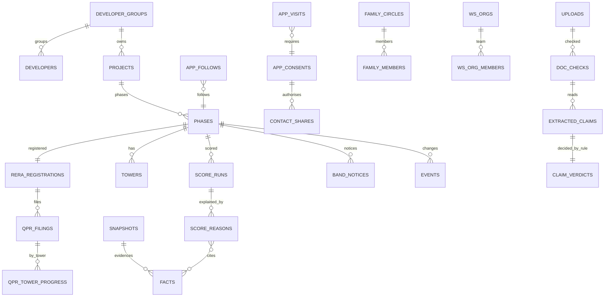

# Plinth data model (Postgres 17 on Supabase)

Status: R1 design, 19 Oct 2026 · Companion to [BUILD_PLAN.md](BUILD_PLAN.md) and [API_CONTRACTS.md](API_CONTRACTS.md)
Seed: every table marked **R1** has §5b rows in `packages/fixtures/canonical/*.json` (DESIGN.md §5/§5b is the only source of fictional facts).

## 0. Conventions

**Schemas** (only `api` is exposed to PostgREST):

| Schema | Holds | Who writes |
|---|---|---|
| `core` | Public records, evidence, scoring and score governance, agent registry, cost rules | `pipeline_writer` (evidence and score drafts); admin/methodology RPCs (publish, corrections) |
| `ws` | Everything a developer authors or operates: orgs, members, "From the developer" content, replies, disputes, Live Record, captures. **`pipeline_writer` has no grant on `ws`**, so developer content structurally cannot feed a band | Developer members, through `api.ws_*` RPCs |
| `app` | Buyer-owned data: follows, alerts, consents, checks, visits, family | Buyers, through `api.*` RPCs |
| `comms` | Outbox, WhatsApp messages and sessions, templates | Edge functions (secret key) |
| `pii` | WhatsApp contacts (phone numbers), relay numbers, member phones | Edge functions only; read through audited functions |
| `ops` | Audit, flags, refs, jobs, review queue, AI log, grievances, error reports | Functions and admin |
| `api` | `SECURITY DEFINER` functions (and a few views) forming the contract | Migration owners |

**Column conventions:**
- **Primary keys:** `id uuid primary key default gen_random_uuid()` unless stated.
- **Timestamps:** `created_at timestamptz not null default now()`. All business-date logic uses `ops.now()`, which honours `plinth.fixed_now` only when `plinth.env` is `test` or `fixture`.
- **Money:** `bigint` whole rupees, named `*_inr`. Percentages: `numeric(5,2)`, named `*_pct`. Areas: `numeric(8,1)` sq ft, named `*_sqft` with an explicit `basis` (carpet or super).
- **Month-precision dates:** stored as `date` (the 1st of the month) plus `*_precision text check (… in ('day','month'))`. "Dec 2027" is `2027-12-01`, precision month.
- **Enums:** `text` + `CHECK` domains (`core.band`, `core.lane`, `core.factor`, `app.verdict`, …), because they are easier to extend than Postgres enums. Values are lower-case snake case.
  - `core.band` ∈ low, moderate, elevated, high, severe.
  - `core.score_state` ∈ scored, limited_history, not_scored.
  - `core.lane` ∈ records_show, developer_says, from_developer, our_estimate, reported_unverified, buyer_upload.
  - `core.factor` ∈ finances, track_record, timeline, legal, site.
  - `app.verdict` ∈ matches, differs, not_in_records, cant_check.

**Human references** come from `ops.next_ref(prefix)` with an IST date. Each format is unique within a year; the year is stored alongside.

| Prefix | Used for | Example |
|---|---|---|
| `C-MMDD-NN` | Consents | C-1018-11 |
| `R-MMDD-NN` | Project requests | R-1018-07 |
| `CL-nnn` | Clerical-lane disputes | CL-201 |
| `D-nnn` | Fact disputes | D-118 |
| `EV-nnn` | Evidence submissions | — |
| `LN-nnn` | Legal notices | LN-031 |
| `E-nnnn` | Error reports | E-0431 |
| `G-nnnn` | Grievances | G-0019 |

**PII tags:** each column carries `comment on column … is 'pii:C0|C1|C2|C3'`. A lint fails on any untagged column whose name matches `phone|email|pan|aadhaar|address|name`.

**RLS notation used below:**
- **api-only:** RLS is on and no grants are given to `anon` or `authenticated`; the table is reachable only through `api.*` functions.
- **own:** `user_id = auth.uid()`.
- **org(roles):** the caller is an active `ws.org_members` member with one of those roles.
- **firewall:** only `published`/`superseded` rows are visible except to `methodology`/`admin`.

Every table has RLS enabled. `service_role` bypasses RLS, and its use is limited to edge functions (see BUILD_PLAN §12).

**Release column:** **R1** = built and seeded in R1; **R1·M#** = R1, landing in that milestone; **R2** = designed now, built later.

---

## 1. `core`: catalogue (developers, projects, RERA)

| Table | Rel. | Key columns | Keys · indexes | RLS / notes |
|---|---|---|---|---|
| `core.localities` | R1·M0 | `kind` (city, zone, corridor, sector), `name`, `slug`, `parent_id`, `geom geography(MultiPolygon,4326)` | uq(`slug`); GIST(`geom`); FK parent → self | api-only. Seeds: Gurugram → Dwarka Expressway, New Gurugram, Golf Course Ext Rd, Sohna Road → Sectors 37D, 113, 106, 89, 92, 102, 104 … |
| `core.developer_groups` | R1·M0 | `slug`, `name`, `claim_state` (unclaimed, invited, claimed), `invited_on`, `claimed_on`, `facts_only_since date null`, `facts_only_line text` | uq(`slug`); trgm(`name`) | api-only. Northfield: invited 24 Nov 2025, claimed 2 Dec 2025. Elmstone, Vantage: invited, not yet claimed. Facts-only is data, not a flag |
| `core.developers` | R1·M0 | `group_id`, `legal_name`, `cin`, `llpin`, `kind`, `status` (active, struck_off, cirp, liquidation), `name_norm` | uq(`cin`) where not null; trgm(`name_norm`); FK group | api-only. Promoter companies and SPVs (Northfield Estates Pvt Ltd, Heronstone Projects …) |
| `core.developer_aliases` | R1·M0 | `developer_id`, `alias`, `snapshot_id`, `confidence` | idx(`developer_id`); trgm(`alias`) | api-only. Name variants ("VATIKA LTD") |
| `core.group_links` | R1·M0 | `group_id`, `developer_id`, `link_type` (spv, common_director, shareholding, collaboration), `status` (proposed, accepted, disputed), `fact_id`, `confidence` | uq(`group_id`,`developer_id`,`link_type`) | api-only. Merges that would move a published score need a person (ops.review_tasks) |
| `core.directors` | R1·M0 | `din` (pk), `name` | — | api-only. **Never phones or addresses**, though HARERA shows them |
| `core.director_links` | R1·M0 | `din`, `developer_id`, `from`, `to` | pk(`din`,`developer_id`) | api-only |
| `core.projects` | R1·M0 | `slug`, `name` (Aurelia Heights), `group_id`, `locality_id`, `footprint geography(Polygon,4326)`, `centroid geography(Point,4326)` | uq(`slug`); GIST(`footprint`), GIST(`centroid`); trgm(`name`) | api-only. Umbrella project; scoring is per phase |
| `core.phases` | R1·M0 | `project_id`, `slug` (page key, e.g. `aurelia-heights-phase-2`), `name`, `promoter_id → developers`, `units_total`, `status` (registered, under_construction, completed, stalled, lapsed, revoked), `short_code` (AH2) | uq(`slug`), uq(`short_code`); idx(`project_id`); trgm(`name`) | api-only. **The unit of a page, a score and a follow.** 8 seeded: Aurelia Ph 2, Kestrel Park, Sapphire Grove Ph 1, Coral Towers, Laurel Residency, Juniper Enclave, Heron Point Ph 2, Cedar Walk Ph 2. Plus the finished Northfield phases for the track record |
| `core.rera_registrations` | R1·M0 | `phase_id`, `authority` (harera_ggm, …), `rera_number`, `registered_on`, `original_completion` + precision, `current_completion`, `status` (valid, lapsed, revoked, deregistered, abeyance), `collection_account_name`, `collection_bank`, `collection_branch`, `collection_account_number`, `collection_ifsc`, `official_url`, `snapshot_id` | uq(`authority`,`rera_number`); idx(`phase_id`) | api-only. The collection account is public record (Peepal Bank, 50200071824417, PEPL0000418) and feeds the payee check. Fixture registration months must reproduce §5b time used (see fixtures CONFLICTS.md) |
| `core.towers` | R1·M0 | `phase_id`, `code` (A/B/C), `floors_planned`, `units` | uq(`phase_id`,`code`) | api-only. Aurelia A–C at 20 floors each |
| `core.unit_types` | R1·M0 | `phase_id`, `label` (3 BHK), `carpet_sqft`, `super_sqft null`, `units null`, `lane` | uq(`phase_id`,`label`) | api-only. Carpet from records; super from the developer's cost sheet |
| `core.qpr_filings` | R1·M0 | `registration_id`, `quarter` ('2026-Q2'), `due_on`, `filed_on null`, `appeared_on null`, `fetched_at null`, `status` (on_time, late, missing, not_yet_due), `days_late int generated`, `sold_pct`, `built_pct`, `time_used_pct`, `collections_inr`, `escrow_withdrawn_inr`, `validation_flags text[]`, `snapshot_id` | uq(`registration_id`,`quarter`); idx(`status`) where status='missing' | api-only. Aurelia has filing rows for all 14 quarters since registration and progress values only for the 8 §5b quarters (no invented figures). Jul–Sep 2026: **missing**, due 15 Oct |
| `core.qpr_tower_progress` | R1·M0 | `filing_id`, `tower_id`, `slab_reached`, `built_pct null` | pk(`filing_id`,`tower_id`) | api-only. From Oct–Dec 2024 (A 4 / B 3 / C 1 … Apr–Jun 2026 A 9 / B 7 / C 5) |
| `core.extensions` | R1·M0 | `registration_id`, `kind` (section6, force_majeure), `granted_on`, `from_completion`, `to_completion`, `order_ref`, `snapshot_id` | idx(`registration_id`) | api-only. Coral: Jan 2026 → Feb 2029; 14 Oct 2026 → Aug 2029 |
| `core.blanket_extensions` | R1·M0 | `authority`, `advisory_on`, `applies_from_completion`, `applies_to_completion null`, `months`, `source_url` | — | api-only. MoHUA advisory of 31 Jul 2026: +4 months for completions on or after 28 Feb 2026 |
| `core.orders` | R1·M0 | `authority`, `case_no`, `decided_on`, `respondent_developer_id`, `phase_id null`, `order_type` (complaint, execution, refund, compensation, extension, sale_ban), `outcome` (against_promoter, for_promoter, withdrawn, other), `snapshot_id`, `extract_method` | uq(`authority`,`case_no`); idx(`phase_id`,`decided_on`) | api-only. Aurelia: 14 against the promoter in 24 months, latest 9 Oct 2026 |
| `core.recovery_certificates` | R1·M6 | `developer_id`, `amount_inr`, `issued_on`, `executed bool`, `snapshot_id` | idx(`developer_id`) | api-only. Developer-level red-flag input |
| `core.insolvency_events` | R1·M0 | `developer_id`, `kind` (petition, admitted, withdrawn, resolved), `event_on`, `forum`, `case_ref`, `snapshot_id` | idx(`developer_id`) | api-only. Elmstone group company admitted, NCLT 12 Mar 2023 |
| `core.licences` | R1·M0 | `phase_id`, `authority` (dtcp), `licence_no`, `valid_to`, `status` | uq(`authority`,`licence_no`) | api-only |
| `core.completion_events` | R1·M0 | `phase_id`, `tower_id null`, `kind` (oc, part_oc, cc), `granted_on`, `audit_flag bool`, `snapshot_id` | idx(`phase_id`) | api-only. Outcome labels: Northfield 6 finished, 2 late |
| `core.reported_incidents` | R1·M1 | `locality_id`, `kind` (waterlogging), `reported_on`, `place_text`, `source_kind` (news, resident), `url`, `lane` = reported_unverified | idx(`locality_id`) | api-only. Sector 37D: 28 Jul 2026, 21 Aug 2025 |
| `core.pre_rera_records` | R1·M1 | `group_id`, `project_name`, `sector`, `promised`, `oc_on null`, `months_late null`, `sources jsonb` | idx(`group_id`) | api-only. Northfield Greens, Alder Court, Larch Enclave. **Never counted in a band** |
| `core.agents` | R1·M5 | `slug`, `name`, `kind` (firm, individual), `principal_name`, `rera_agent_no`, `authority`, `valid_to`, `status` (active, ended), `office_locality_id`, `verified_since null`, `badge_since null`, `partner bool` | uq(`authority`,`rera_agent_no`); trgm(`name`) | api-only (`api.agent_check`). Larkspur, Kabir Malhotra, Arora, Bluegate, Northgate (ended 30 Jun 2026), Meadowline (UP) |
| `core.cost_rule_sets` | R1·M1 (calculators M3) | `version` ('2026.10'), `state` ('HR'), `effective_from`, `gst_uc_pct` 5, `stamp_duty_pct {male 7, female 5, joint 6}`, `registration_fee_inr` 50000, `rounding` jsonb | uq(`version`,`state`) | api-only. Reproduces ₹2,74,00,400 → "₹2.74 Cr", ₹18,900/sq ft carpet |

## 2. `core`: evidence

| Table | Rel. | Key columns | Keys · indexes | RLS / notes |
|---|---|---|---|---|
| `core.sources` | R1·M0 | `code` (harera_registration, harera_qpr, harera_qpr_register, harera_orders, harera_corrigendum, dtcp_oc, ibbi, news, developer_workspace), `name`, `base_url`, `cadence`, `terms_note` | uq(`code`) | api-only |
| `core.snapshots` | R1·M0 | `source_id`, `url`, `method`, `params jsonb`, `fetched_at`, `http_status`, `sha256 char(64)`, `storage_key`, `content_type`, `bytes`, `parser_version`, `fixture bool` | uq(`sha256`,`url`); idx(`source_id`,`fetched_at`) | api-only. **Immutable**: a trigger blocks update and delete. Bucket `snapshots` is write-once |
| `core.facts` | R1·M0 | `subject_type` (phase, developer, group, tower, registration), `subject_id`, `attribute` (e.g. `qpr.built_pct`), `value jsonb`, `as_of`, `valid_from`, `valid_to`, `learned_at`, `snapshot_id`, `page_ref`, `extract_text`, `method` (parser, llm_x2, manual, developer), `method_version`, `read_note` ("Read by two AI extractors; they matched. Checked by a person on 16 Jul 2026."), `confidence`, `reviewer_id`, `reviewed_at`, `lane`, `superseded_by → facts` | idx(`subject_type`,`subject_id`,`attribute`) where `superseded_by is null`; idx(`snapshot_id`) | api-only (`api.evidence`). Bitemporal; superseded, never updated |
| `core.events` | R1·M2 | `phase_id`, `kind` (band_changed, qpr_filed, qpr_missing, qpr_late, extension_granted, order_decided, price_list_published, oc_granted, cirp_admitted, rescore_started, developer_replied, construction_update), `occurred_on`, `detected_at`, `public bool`, `summary_text`, `before jsonb`, `after jsonb`, `fact_ids uuid[]`, `run_id null` | idx(`phase_id`,`detected_at`); idx(`kind`) | api-only. Drives alerts, Since you last looked, the digest and the replay. Rohan sees 5 since 14 Oct 08:40 |
| `core.share_cards` | R1·M2 | `phase_id`, `kind` (risk, cost, visit, digest), `run_id`, `issued_at`, `data_as_of`, `model_version`, `band`, `phash bit(64)`, `short_code` | uq(`short_code`); idx(`phase_id`) | api-only. Lets an old forwarded card answer "Changed since this card was sent" (the 26 Jun 2026 v1.1 Moderate example) |

## 3. `core`: scoring and governance

| Table | Rel. | Key columns | Keys · indexes | RLS / notes |
|---|---|---|---|---|
| `core.score_models` | R1·M0 | `version` (v1.0, v1.1, v1.2), `released_on`, `status`, `config jsonb` (bins, WoE, coefficients, band thresholds, confidence rules, factor weights 30/30/20/15/5), `config_sha`, `changelog` | uq(`version`) | api-only (`api.methodology`). v1.0: 15 Jul 2026. v1.2: 14 Oct 2026 (adds the MoHUA blanket extension) |
| `core.score_runs` | R1·M0 | `phase_id`, `model_version`, `data_cutoff`, `computed_at`, `code_commit`, `status` (draft, pending_notice, published, superseded, withdrawn), `state` (core.score_state), `band null`, `set_by` (model, red_flag_rule), `rule_code null`, `confidence` (high, low, null), `p_late12 numeric`, `freq_low`, `freq_high`, `freq_point`, `internal_points` (**never exposed**), `stall bool`, `stale bool`, `what_would_change`, `supersedes_run_id`, `published_at`, `notice_id null` | idx(`phase_id`,`status`); partial uq(`phase_id`) where `status='published'` | **firewall**. pgTAP: support/agent/developer roles read 0 draft rows |
| `core.score_reasons` | R1·M0 | `run_id`, `rank` 1–4, `factor`, `code` (FIN_SOLD_AHEAD_BUILT …), `text`, `contribution`, `fact_ids uuid[]` | pk(`run_id`,`rank`) | firewall (inherits the run) |
| `core.reason_templates` | R1·M0 | `code`, `factor`, `template_en`, `version` | uq(`code`,`version`) | api-only. Reason catalogue; an LLM never adds facts |
| `core.red_flag_rules` | R1·M0 | `code` (RF1_GROUP_CIRP, RF2_REGISTRATION_REVOKED, RF3_STOP_SALE, RF4_GROUP_DEFAULT), `text`, `published_on` | uq(`code`) | api-only. Published rules |
| `core.red_flags` | R1·M0 | `rule_code`, `subject_type`, `subject_id`, `triggered_on`, `cleared_on null`, `fact_ids` | idx(`subject_type`,`subject_id`) where `cleared_on is null` | api-only. Laurel via the Elmstone group |
| `core.band_history` | R1·M0 | `phase_id`, `band null`, `state`, `confidence`, `from_date`, `to_date null`, `run_id`, `model_version` | idx(`phase_id`,`from_date`) | api-only, published only. Aurelia: Moderate 15 Jul → 2 Oct 2026 (v1.0/1.1); Elevated from 2 Oct (v1.1; v1.2 on 14 Oct unchanged) |
| `core.band_notices` | R1·M4 | `phase_id`, `kind` (notice_7day, heads_up_48h, red_flag_immediate), `from_band`, `to_band`, `proposed_run_id`, `reason_text`, `trigger_fact_ids`, `sent_at`, `effective_on`, `public_marker_text`, `status` (pending, held, effective, withdrawn, superseded) | idx(`phase_id`,`status`) | `to_band` is readable only by org(admin, compliance) of the phase's group, methodology and admin. Buyers see only `public_marker_text` ("If it is still missing on 25 Oct 2026, this band may change"). Seeds: heads-up 30 Sep 2026; 7-day notice 18 Oct, effective 25 Oct |
| `core.calibration` | R1·M1 | `model_version`, `band`, `range_low`, `range_high`, `n_projects`, `n_late`, `per_100`, `illustrative bool`, `brier`, `brier_baseline` | uq(`model_version`,`band`) | api-only. The illustrative 212-phase table; base rate 36 of 100 |
| `core.methodology_changelog` | R1·M1 | `version`, `published_on`, `summary`, `minutes_url` | — | api-only |

## 4. `ws`: developer workspace, "From the developer" and due process

| Table | Rel. | Key columns | Keys · indexes | RLS / notes |
|---|---|---|---|---|
| `ws.orgs` | R1·M4 | `kind` (developer, agent_firm), `group_id null`, `agent_id null`, `name`, `email_domain`, `claim_code_hash`, `claim_code_expires`, `signatory_verified_at` | uq(`group_id`), uq(`agent_id`) | org(any) read own. Ashgrove: code ASH-7Q4K-2M, valid 30 days |
| `ws.org_members` | R1·M4 | `org_id`, `user_id`, `role` (admin, sales, compliance, marketing, site), `display_name`, `invited_at`, `accepted_at`, `whatsapp_alerts bool` | uq(`org_id`,`user_id`) | org(admin) manages; members read their own org. Northfield: Ananya Rao (Admin) … Pradeep Yadav (Site) |
| `ws.signatory_checks` | R1·M4 | `org_id`, `kind` (domain_email, board_resolution, harera_contact), `status`, `upload_id`, `decided_by`, `decided_at` | uq(`org_id`,`kind`) | org(admin); reviewers via admin RPC |
| `ws.site_offices` | R1·M4 | `org_id`, `phase_id`, `name` (Sector 37D sales gallery), `geom geography(Point)` | idx(`phase_id`) | org(any) |
| `ws.visit_slots` | R1·M5 | `site_office_id`, `starts_at`, `capacity` (3), `open bool` | uq(`site_office_id`,`starts_at`) | org(sales, site, admin) write; slot availability via `api.visit_slots` |
| `ws.price_lists` | R1·M1 (editing M4) | `phase_id`, `published_on`, `status` (draft, published), `version`, `lane` = from_developer, `published_by` | idx(`phase_id`,`published_on`) | Drafts: org(marketing, admin). Published: via `api.project_page`. Never deleted. Aurelia lists: Jan 2023, 1 Jul 2025, 1 Apr 2026, 2 Oct 2026 |
| `ws.price_list_items` | R1·M1 | `price_list_id`, `unit_type_id`, `base_price_inr`, `per_sqft_carpet_inr` | pk(`price_list_id`,`unit_type_id`) | As above |
| `ws.payment_plans` | R1·M1 | `phase_id`, `kind` (construction_linked, down_payment, possession_linked, subvention), `name`, `published_on`, `status` | idx(`phase_id`) | As above |
| `ws.payment_plan_stages` | R1·M1 | `plan_id`, `seq`, `label`, `stage_kind` (booking, agreement, foundation, slab, brickwork, finishing, possession), `slab_no null`, `pct` | pk(`plan_id`,`seq`) | As above. Aurelia's 11 rows; slabs 3/6/9/12/15/18/20 at 7.5% |
| `ws.cost_sheets` | R1·M1 | `phase_id`, `unit_type_id`, `dated`, `unit_label` (park-facing), `carpet_sqft`, `super_sqft`, `lane` (from_developer) | idx(`phase_id`,`dated`) | Published via `api.cost_breakdown`. Other phases are summary-only (all-in, ₹/sq ft) |
| `ws.cost_sheet_lines` | R1·M1 | `cost_sheet_id`, `seq`, `code` (base, plc, club, parking, ifms, edc_idc_included), `label`, `amount_inr`, `tag` (often_negotiable, set_by_law, included_in_base, refundable_deposit) | pk(`cost_sheet_id`,`seq`) | As above. Base ₹2.35 Cr, PLC ₹2.9 L, club ₹1.5 L, parking ₹3.5 L, IFMS ₹1.3 L |
| `ws.developer_documents` | R1·M1 | `phase_id`, `kind` (floor_plan, brochure, transfer_policy, draft_agreement), `dated`, `storage_key`, `summary jsonb`, `lane` | idx(`phase_id`) | Published rows readable through api. Transfer policy: ₹150/sq ft super |
| `ws.developer_claims` | R1·M1 | `phase_id`, `text` ("filed on 12 Oct 2026"), `said_on`, `check_by`, `verified_state` (unverified, verified, contradicted), `linked_fact_id null`, `public bool` | idx(`phase_id`) where unverified | Shown as the "Developer says" tone field, never as a record |
| `ws.developer_replies` | R1·M1 | `phase_id`, `run_id null`, `text`, `signatory_title`, `published_at`, `check_by`, `status` (draft, published) | idx(`phase_id`,`published_at`) | Published 15 Oct 2026; check by 5 Nov 2026 |
| `ws.disputes` | R1·M4 | `ref` (CL-/D-/EV-), `lane` (clerical, dispute, evidence), `phase_id`, `fact_id null`, `reason_rank null`, `raised_by`, `raised_at`, `sla_due`, `status` (received, checking, upheld, rejected, fixed_our_error, matched, unmatched), `decision_text`, `decided_at`, `counts_toward_quota bool` | uq(`ref`); idx(`phase_id`,`status`) | org(admin, compliance). A public log via `api.dispute_log` (redacted). Quota 6 per scored phase per quarter (12 for Northfield). CL-201, D-118, D-127, CL-202 |
| `ws.dispute_events` | R1·M4 | `dispute_id`, `at`, `kind`, `note` | idx(`dispute_id`) | As above |
| `ws.legal_intakes` | R1·M4 | `ref` (LN-031), `org_id`, `kind` (legal_notice, grievance, court_or_regulator_order), `received_at`, `ack_due` (48 h), `pack_due` (5 working days), `reply_due` (15 working days), `status`, `routed_to` = counsel | uq(`ref`) | org(admin) only; counsel via admin RPC. Never routed to the scoring team |
| `ws.live_record_links` | R1·M4 | `phase_id`, `code` (AH2), `short_url` | uq(`code`) | Public resolve via `/r/[code]` |
| `ws.live_record_placements` | R1·M4 | `link_id`, `code` (AH2-H1, AH2-B3, AH2-W), `kind` (hoarding, brochure, website, social, whatsapp) | uq(`code`) | org(marketing, admin) |
| `ws.live_record_scans_daily` | R1·M4 | `placement_id`, `day`, `scans` | pk(`placement_id`,`day`) | Counts only, **never who scanned**. October: 214 / 61 / 138 |
| `ws.brand_terms` | R1·M4 | `org_id`, `version`, `accepted_at`, `accepted_by` | — | Accepted 2 Sep 2026 |
| `ws.capture_links` | R1·M4 | `org_id`, `member_id`, `phase_id`, `token_hash`, `opened_at`, `expires_at` (24 h), `used_at` | uq(`token_hash`) | Capture RPC with token |
| `ws.site_captures` | R1·M4 | `link_id`, `tower_id`, `slab_no`, `storage_key`, `sha256`, `captured_at`, `network_time`, `inside_footprint bool`, `accuracy_m`, `status` (sealed, rejected_no_location) | idx(`link_id`) | **No raw GPS stored.** Label "Location-verified · from the developer"; never moves a score |
| `ws.construction_updates` | R1·M4 | `phase_id`, `published_at`, `capture_ids uuid[]`, `notified_at` | idx(`phase_id`) | Followers get at most 1 a month |
| `ws.crm_handoffs` | R1·M4 | `org_id`, `mode` (email, csv; webhook = R2), `email`, `last_sent_at` | uq(`org_id`,`mode`) | Same for every developer; no tiers |
| `ws.buyer_signals_monthly` | R1·M4 | `phase_id`, `month`, `visitors`, `saw_band_pct`, `band_shown`, `new_followers`, `top_questions jsonb`, `opened_facts jsonb`, `suppressed_rows` | pk(`phase_id`,`month`) | org(any). **k ≥ 20 enforced at build time**: counts under 20 are stored as null and shown as "fewer than 20" |
| `ws.draft_phases` | R1·M4 | `org_id`, `name` (Cedar Walk Ph 3), `facts jsonb`, `approvals jsonb`, `publish_price_on_registration bool` | — | org(admin, marketing) only; never public before a RERA number |
| `ws.webhook_endpoints` | R2 | Signed CRM webhook | — | — |

## 5. `app`: buyers (accounts, follows, alerts, family)

| Table | Rel. | Key columns | Keys · indexes | RLS / notes |
|---|---|---|---|---|
| `app.profiles` | R1·M2 | `id → auth.users`, `first_name`, `phone_masked` ("+91 99••• ••318"), `following_seen_at`, `adult_attested_at`, `created_at` | pk(`id`) | own. Created by a trigger on `auth.users` (the pet_app pattern) |
| `app.user_roles` | R1·M2 | `user_id`, `role` (buyer, agent, developer_member, reviewer, methodology, admin, support), `granted_by` | pk(`user_id`,`role`) | admin only; read by the access-token hook |
| `app.devices` | R1·M2 | `user_id`, `fcm_token`, `platform`, `app_version`, `last_seen` | uq(`fcm_token`) | own |
| `app.follows` | R1·M2 | `user_id`, `phase_id`, `follow_type` (watching, booked), `source` (web, app, whatsapp, family), `followed_at` | uq(`user_id`,`phase_id`); idx(`phase_id`) | own. **`follow_type` is never visible to circle members.** Rohan: 4 since 1 Jul 2026 |
| `app.alert_subscriptions` | R1·M2 | `user_id`, `channel` (push, whatsapp, email), `kind` (band_change, filings, orders, extensions, price, digest, payment_stage), `cadence` (instant, daily_8am, weekly_sun_9am, off), `quiet_from`, `quiet_to`, `enabled` | uq(`user_id`,`channel`,`kind`) | own. Rohan: WhatsApp on, digest weekly (next Sun 25 Oct, 9 am) |
| `app.saved_searches` | R1·M2 | `user_id`, `filters jsonb`, `label`, `in_digest bool` | idx(`user_id`) | own. Matches are not sent as utility alerts |
| `app.project_requests` | R1·M2 | `ref` (R-1018-07), `user_id null`, `name_text`, `rera_text`, `due_on` (+14 days), `status` (open, added, declined), `reason` | uq(`ref_year`,`ref`) | own + admin |
| `app.family_circles` | R1·M2 | `owner_user_id`, `created_at` | uq(`owner_user_id`) | own |
| `app.family_members` | R1·M2 | `circle_id`, `member_user_id null`, `wa_contact_id null`, `invite_code` (AH2-7KQ), `scope_phase_ids uuid[]` or `scope_all bool`, `status` (invited, joined, left, removed, expired), `invited_at`, `expires_at` (7 days), `joined_at`, `joined_via` (whatsapp, app), `can_add_notes` | uq(`invite_code`); idx(`circle_id`) | Owner manages; a member reads their own row. **Carries no phone.** The relative's own "JOIN <code>" message is the opt-in. Members are not cap parties |
| `app.shortlist_notes` | R1·M2 | `circle_id`, `phase_id`, `author_user_id`, `body`, `created_at` | idx(`circle_id`) | Circle owner and joined members |
| `app.data_requests` | R1·M2 | `user_id`, `kind` (export, erasure, correction), `requested_at`, `due_at`, `completed_at`, `export_key`, `link_expires_at` | idx(`user_id`) | own + admin. Export within 24 h; link valid 7 days |
| `app.ask_threads` / `app.ask_messages` | R1·M5 | thread: `user_id null`, `wa_contact_id null`, `channel`. Message: `role`, `text`, `answer jsonb` (sentences + fact ids), `refusal_code`, `ai_generation_id`, `feedback` | idx(`thread_id`) | own; anonymous web threads are keyed by a signed session id. 24-month retention |
| `app.pro_purchases` | R1·M6 | `user_id`, `phase_id`, `price_inr` (999), `provider`, `provider_ref`, `paid_at`, `refund_until` (+7 days), `refunded_at`, `updates_until` | uq(`provider`,`provider_ref`) | own. Behind `pro_paywall` (needs a payment partner) |

## 6. `app`: consent ledger, contact shares, relay

| Table | Rel. | Key columns | Keys · indexes | RLS / notes |
|---|---|---|---|---|
| `app.purposes` | R1·M2 | `code` (account, alerts, visit_share, enquiry_share, agent_brief, number_share, analytics, ai_processing, family_alerts), `description`, `retention_class`, `notice_section` | pk(`code`) | Readable through `api.purposes` |
| `app.notice_versions` | R1·M2 | `version`, `published_at`, `url`, `sha256`, `language` | pk(`version`) | Public read |
| `app.consents` | R1·M2 | `ref` (**C-MMDD-NN**), `ref_year`, `principal_user_id`, `purpose_code`, `recipient_kind` (site_office, sales_office, agent, plinth), `recipient_org_id null`, `recipient_agent_id null`, `phase_id null`, `notice_version`, `channel`, `evidence jsonb` (tap_event_id / wa_message_id), `scope jsonb` (first_name, brief fields), `granted_at`, `expires_at null` | uq(`ref_year`,`ref`); idx(`principal_user_id`); idx(`recipient_org_id`) | own read. **Insert-only, and only through RPCs called with the principal's JWT.** Rohan: C-1018-11, C-1015-02, C-1012-05, C-1012-04, C-0902-01 |
| `app.consent_withdrawals` | R1·M2 | `consent_id`, `withdrawn_at`, `channel` (web, app, whatsapp_keyword), `partner_notified_at` | uq(`consent_id`) | own. Triggers end the share and close the relay |
| `app.contact_shares` | R1·M2 | `consent_id`, `buyer_user_id`, `recipient_org_id null`, `recipient_agent_id null`, `phase_id`, `number_shared bool`, `relay_session_id null`, `starts_at`, `ends_at`, `ended_reason` | idx(`buyer_user_id`, `starts_at`) | own read; org(sales, site, admin) read masked through `api.ws_inbox`. **Trigger 1:** `number_shared = true` only when `auth.uid() = buyer_user_id` and `evidence.tap_event_id` is present (the service role is rejected too). **Trigger 2 (cap):** ≤ 3 active number-holding parties per buyer in a rolling 30 days. Rohan: 3 can reach him |
| `app.relay_sessions` | R1·M2 | `buyer_user_id`, `recipient_org_id`, `phase_id`, `channel` (whatsapp_text; call_mask = R2), `deal_active bool`, `opened_at`, `last_message_at`, `closes_at` (last message + 30 days unless renewed), `closed_at` | idx(`buyer_user_id`) | own; org via the inbox RPC. A relay doesn't count toward the cap |
| `pii.relay_numbers` | R2 | `provider`, `e164`, `status`, `session_id` | — | Call masking (decision D-2) |

## 7. `app`: checks (claims, cost sheet, pay-as-built, before you pay)

| Table | Rel. | Key columns | Keys · indexes | RLS / notes |
|---|---|---|---|---|
| `app.uploads` | R1·M3 | `owner_user_id null`, `wa_contact_id null`, `kind` (flyer, brochure, hoarding_photo, cost_sheet, demand_letter, payment_request, receipt, voice_note, room_photo), `storage_key`, `sha256`, `mime`, `pages`, `saved bool`, `retain_until` (+30 days), `deleted_at` | idx(`sha256`); idx(`retain_until`) where not saved | own. Same file hash → re-run of the earlier check ("Checked again … 1 row changed") |
| `app.doc_checks` | R1·M3 | `upload_id`, `kind` (claims, cost_sheet, pay_as_built, before_you_pay, visit_recap), `channel`, `status` (reading, confirm_project, checking, done, unreadable, partly_readable, no_claims, outside_coverage), `phase_id null`, `match_method` (rera_number, name_sector, user_pick), `confirmed_at`, `summary jsonb` ("4 of 7 claims differ…"), `rules_version` | idx(`upload_id`); idx(`status`) | own. Nothing is checked before the project is confirmed |
| `app.extracted_claims` | R1·M3 | `check_id`, `seq`, `claim_type` (possession_date, price, all_in, area, rera_number, oc_status, sold_left, amenity, demand_stage, plan_stage, amount, payee_name, account_number, ifsc, banned_phrase), `raw_text`, `value jsonb`, `unit`, `qualifier` (super, carpet, all_in, base), `bbox jsonb`, `page`, `confidence`, `reader_a jsonb`, `reader_b jsonb`, `agreed bool`, `review_task_id null` | idx(`check_id`) | own. Third-party phone numbers are masked at ingest |
| `app.claim_verdicts` | R1·M3 | `claim_id`, `verdict` (app.verdict), `records_text`, `how_checked`, `fact_ids`, `checkable_on null`, `broker_question`, `rule_code`, `rule_version` | pk(`claim_id`) | own. Rules, not AI |
| `app.cost_sheet_reads` | R1·M3 | `check_id`, `lines jsonb`, `all_in_inr`, `per_sqft_carpet_inr`, `loading_pct`, `negotiable_inr`, `rules_version` | pk(`check_id`) | own |
| `app.bookings` | R1·M3 | `user_id`, `phase_id`, `tower_id`, `unit_no` (A-1104), `price_inr`, `booked_on`, `agreement_registered_on`, `paid_to_date_inr`, `plan_id` | idx(`user_id`) | own. **Never visible to the family circle.** Kavya Nair: ₹1,67,20,000, 52.5% paid |
| `app.payee_checks` | R1·M3 | `user_id null`, `phase_id`, `payee_name`, `account_last4`, `account_sha256`, `ifsc`, `amount_inr`, `stage` (before_agreement, after_agreement), `method` (transfer, cheque, cash), `result jsonb` (per-field matches, cap check) | idx(`user_id`) | own. The full account number is hashed, never stored, since the registered one is in `core` |
| `app.receipts` | R1·M3 | `user_id`, `phase_id`, `upload_id`, `amount_inr`, `paid_on`, `utr_last4`, `checks jsonb` | idx(`user_id`) | own. Kept until the user deletes it. EOI ₹11,00,000, UTR …7731 |
| `app.staging_jobs` | R1·M5 | `upload_id`, `style`, `status`, `output_key`, `structure_check bool`, `label_burned bool`, `c2pa_sha256`, `ai_generation_id` | idx(`upload_id`) | own |

## 8. `app` + `core`: visits, agents, introductions

| Table | Rel. | Key columns | Keys · indexes | RLS / notes |
|---|---|---|---|---|
| `app.visits` | R1·M5 | `buyer_user_id`, `phase_id`, `site_office_id`, `slot_start`, `visitors`, `code` (4821), `consent_id`, `agent_of_record_id null`, `status` (booked, checked_in, no_show, cancelled, done), `booked_at`, `checked_in_at`, `checked_in_by` | uq(`site_office_id`,`slot_start`::date,`code`) | own; org(sales, site) through `api.ws_inbox` / `api.ws_check_in`. Rohan Sat 24 Oct 11 am (C-1018-11); Aman 5190; Nisha 3376 |
| `app.visit_questions` | R1·M5 | `visit_id`, `seq`, `record_line`, `question`, `fact_ids`, `sent_ahead bool` | pk(`visit_id`,`seq`) | own; the site office sees only `sent_ahead` rows |
| `app.visit_recaps` | R1·M5 | `visit_id`, `transcript`, `recorded_at`, `duration_s`, `audio_deleted_at`, `check_id → doc_checks` | pk(`visit_id`) | own. Filed as "Developer says · sales office · unverified"; never published, never moves a band |
| `app.enquiries` | R1·M4 | `buyer_user_id`, `phase_id`, `kind` (price_list, payment_plan, unit), `brief jsonb` (only fields the buyer ticked), `questions`, `consent_id`, `agent_of_record_id null`, `status` (new, replied), `replied_at` | idx(`phase_id`,`status`) | own; org(sales, admin) through the inbox RPC. Ishita, Farah, Dev |
| `app.agent_members` | R1·M5 | `user_id`, `agent_id`, `role` | pk(`user_id`,`agent_id`) | own |
| `app.agent_of_record` | R1·M5 | `buyer_user_id`, `phase_id`, `agent_id`, `consent_id`, `set_at`, `source` (visit_flow, profile_connect) | uq(`buyer_user_id`,`phase_id`) | own; the agent reads through an RPC. Larkspur for Kestrel Park (C-1012-05) |
| `app.introductions` | R1·M5 | `agent_id`, `buyer_user_id`, `phase_id`, `consent_id`, `first_contact_at`, `last_verified_visit_at`, `window_ends_on` (+60 days), `hard_stop_on` (+90 days from first), `status` | idx(`agent_id`) | Agent members read their own; the buyer reads their own. Logged in R1 as proof; **no money in R1** |
| `app.agent_briefs` | R1·M5 | `agent_id`, `buyer_user_id`, `phase_id`, `consent_id`, `fields jsonb` (shown fields; others "Not shared"), `relay_session_id` | idx(`agent_id`) | As above |
| `core.agent_badges`, `app.agent_reviews` | R2 | Monthly badge compute; verified-visit reviews | — | — |
| `app.mandates`, `app.listings`, `app.media_assets`, `app.commission_ledger` | R2 | Resale listings, owner OTP mandates, fee splits (draft rules v1, counsel sign-off first) | — | — |
| `app.transferability_checks`, `app.deal_rooms`, `app.loan_referrals` | R2 | Resale and loans ("Loan checks arrive in 2027") | — | — |

## 9. `comms` and `pii`: messaging

| Table | Rel. | Key columns | Keys · indexes | RLS / notes |
|---|---|---|---|---|
| `pii.wa_contacts` | R1·M2 | `wa_id_e164`, `user_id null`, `first_seen`, `last_inbound_at` (24-hour window), `utility_opt_in bool`, `stopped_at null` | uq(`wa_id_e164`) | Edge only; `api.who_has_my_number` shows masked values. Linked to an account only after the user taps "Bring them here" |
| `pii.member_phones` | R1·M4 | `org_member_id`, `e164` | pk(`org_member_id`) | Edge only (WaDevAlerts) |
| `comms.wa_sessions` | R1·M2 | `contact_id`, `state`, `context jsonb`, `expires_at` | pk(`contact_id`) | Edge only. Conversation state machine |
| `comms.wa_messages` | R1·M2 | `contact_id`, `direction`, `wa_message_id`, `type`, `payload jsonb` (redacted), `template_code null`, `status` (received, sent, delivered, read, failed, mock_sent), `created_at`, `retain_until` (+24 months) | uq(`wa_message_id`); idx(`contact_id`,`created_at`) | Edge + admin inbox. Idempotent on `wa_message_id` |
| `comms.templates` | R1·M2 | `code`, `channel`, `meta_name`, `category` (utility, authentication), `language` (en), `status` (draft, submitted, approved, rejected), `body`, `buttons jsonb`, `header` | uq(`code`) | Admin. The catalogue mirrors `catalogues/wa_templates.json` |
| `comms.outbox` | R1·M2 | `dedupe_key`, `user_id null`, `contact_id null`, `org_member_id null`, `channel` (push, whatsapp_template, whatsapp_session, email, sms), `template_code`, `payload jsonb`, `basis` (subscription id or consent ref), `not_before` (quiet hours, digest time), `status` (queued, sending, sent, delivered, failed, suppressed), `attempts`, `last_error`, `provider_message_id`, `sent_at` | uq(`dedupe_key`); idx(`status`,`not_before`) | Edge only. Every send is DPDP evidence |

## 10. `ops`

| Table | Rel. | Key columns | Keys · indexes | RLS / notes |
|---|---|---|---|---|
| `ops.audit_log` | R1·M0 | `id bigserial`, `at`, `actor_user_id`, `actor_role`, `request_id`, `action`, `entity`, `entity_id`, `before jsonb`, `after jsonb`, `reason` | idx(`entity`,`entity_id`); idx(`at`) | Insert-only (trigger); admin reads. ≥ 2 years |
| `ops.ref_counters` | R1·M0 | `prefix`, `scope_date`, `last` | pk(`prefix`,`scope_date`) | `ops.next_ref()` only |
| `ops.feature_flags` | R1·M0 | `key`, `enabled`, `rollout_pct`, `audience`, `surfaces text[]`, `note`, `updated_by` | pk(`key`) | Admin writes; `api.flags()` reads |
| `ops.job_runs` | R1·M1 | `pipeline`, `source_code`, `started_at`, `finished_at`, `mode` (fixtures, live), `fetched`, `changed`, `parsed`, `yield_pct`, `errors jsonb` | idx(`source_code`,`started_at`) | Admin; `pipeline_writer` insert |
| `ops.source_freshness` (view) | R1·M1 | Per source: last success, age ÷ cadence, yield delta | — | Admin |
| `ops.review_tasks` | R1·M3 | `kind` (extraction_disagreement, low_confidence_claim, dispute, clerical, notice, legal, capture, entity_merge, demand_check), `entity`, `entity_id`, `priority` (impact × uncertainty), `status`, `assignee`, `due_at` | idx(`status`,`priority`) | Reviewer and admin |
| `ops.ai_generations` | R1·M3 | `task`, `model`, `prompt_version`, `input_sha256`, `output jsonb` (redacted), `tokens_in`, `tokens_out`, `cost_inr`, `latency_ms`, `cited_fact_ids`, `refusal_code`, `mode` (live, recorded) | idx(`task`,`created_at`) | Admin. 12-month retention |
| `ops.rate_limits` | R1·M2 | `bucket`, `key_hash`, `window_start`, `count` | pk(`bucket`,`key_hash`,`window_start`) | Edge |
| `ops.error_reports` | R1·M1 | `ref` (E-0431), `user_id null`, `phase_id`, `fact_id null`, `text`, `status`, `sla_due` (15 working days) | uq(`ref`) | own + admin. "Report an error in this row" |
| `ops.grievances` | R1·M2 | `ref` (G-0019), `user_id null`, `kind`, `received_at`, `ack_due` (24 h), `resolve_due` (7 days), `status` | uq(`ref`) | own + admin |
| `ops.holdings_declarations` | R1·M1 | `person_role`, `declared_on`, `holdings text` | — | Public through `api.about` (WebAbout). Founder supplies the real values |

## 11. Relationships (core path)

## 12. Invariants (each has a pgTAP test)

1. `anon` and `authenticated` can `SELECT` from no table in any schema; `api.*` functions are the only door.
2. Draft and pending score runs and their reasons are invisible to every role except methodology and admin. A pending notice's `to_band` is visible only to the developer org's admin and compliance roles.
3. `core.snapshots`, `core.facts`, `core.score_runs` (except the status transitions draft → pending_notice → published → superseded), `app.consents` and `ops.audit_log` reject `UPDATE` and `DELETE`.
4. `app.contact_shares.number_shared = true` is impossible without the buyer's own JWT and a tap-event id. No path exceeds 3 active number holders per buyer in 30 days.
5. Family members cannot read `app.bookings`, `app.follows.follow_type`, `app.consents`, `app.contact_shares`, `app.visits`, `app.doc_checks` or payment alerts of the circle owner.
6. `pipeline_writer` has no privileges on `ws`, `app`, `pii` or `comms`. Developer content cannot reach scoring.
7. Developer org members see only enquiries and visits with an active consent naming their org. A phone number appears only where `number_shared` is true and not withdrawn.
8. `api.risk_summary` returns `band = null` (and no reasons or frequency) when `bands_public` is off, the group is facts-only, or the state isn't `scored`.
