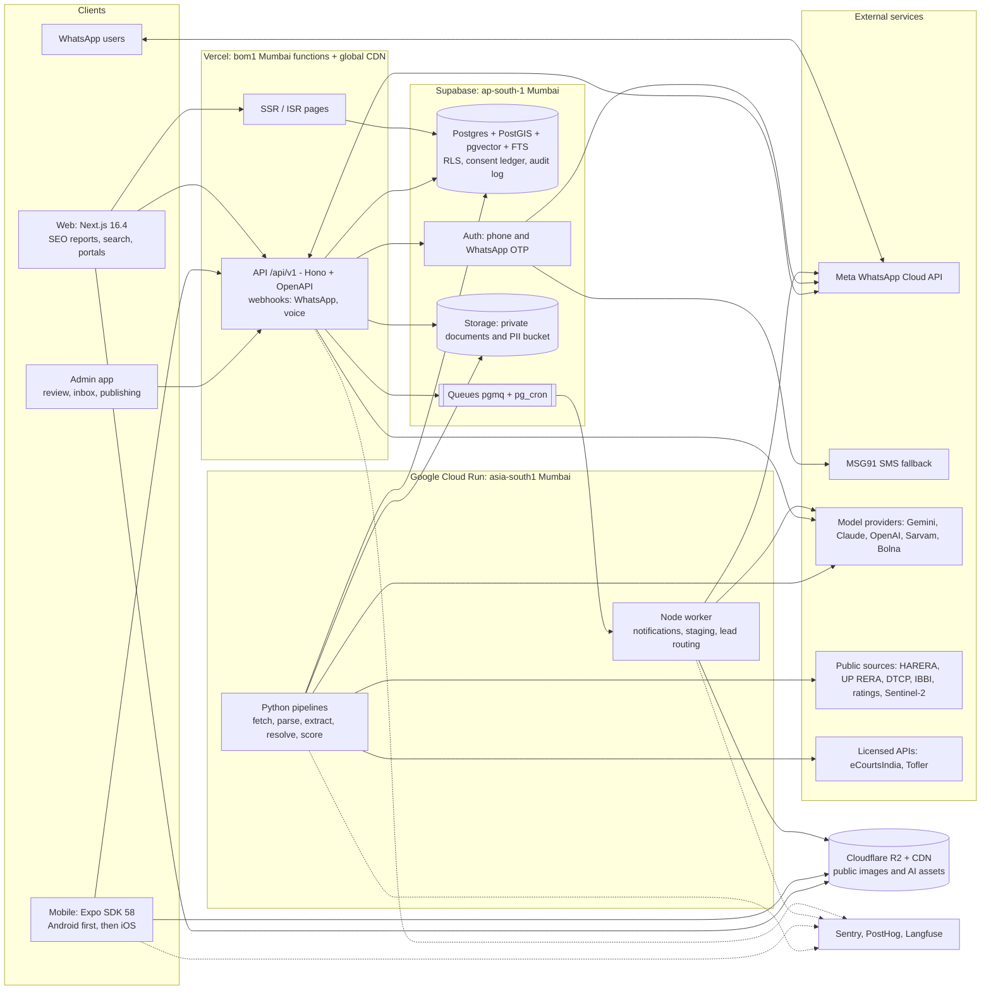
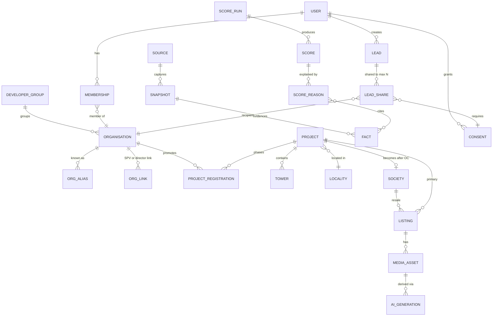
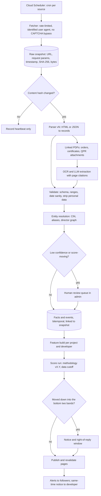

# Platform strategy and technical architecture (specialist input to the PRD)

Role: platform, data and technical architecture · Date: 18 Oct 2026 · Status: recommendation for the senior PM

**Inputs reused (not re-researched):**
- `product/BRIEF.md`
- `research_notes/Developer and project risk scoring/ncr_risk_data_sources.md`
- `research_notes/Delhi NCR AI real estate platform/ai_opportunities.md`
- the regulatory sections of `reports/Delhi NCR AI real estate platform.md`
- `legal_risk_and_score_ux.md` (score governance)

**Conventions:**
- Vendor prices and platform facts were re-checked on the linked pages on **18 Oct 2026**.
- "(research note)" marks a fact taken from the Phase 1 notes, dated 17–18 Oct 2026.
- **Judgement** marks my own recommendation.
- Currency is converted at ₹92 = US$1, as in the research notes. Prices exclude 18% GST unless stated.

---

## 1. Summary

1. **One language for product code.** A TypeScript monorepo: Next.js 16.4 (web), Expo SDK 58 / React Native 0.88 (Android and iOS) and a Hono API. Python only for scrapers, extraction and scoring. AI coding tools are strongest here, and all surfaces share schemas, API client, design tokens and i18n.
2. **Web and WhatsApp at MVP, apps in Phase 2.** Server-rendered risk reports acquire users; WhatsApp keeps them. Android then iOS ship from one Expo codebase; a PWA bridges the gap.
3. **Three managed vendors, all computing in Mumbai.** Supabase (ap-south-1: Postgres with PostGIS, pgvector and FTS, plus auth, storage, queues), Vercel (bom1: web and API), Google Cloud Run (asia-south1: workers and pipelines). No Kubernetes, Redis or search cluster at MVP.
4. **Every claim is traceable.** Each on-screen fact links to a raw source snapshot (URL, timestamp, SHA-256, stored bytes). A score is an immutable run with methodology version, data cutoff and reason codes that cite facts.
5. **Risk pipeline order:** HARERA, DTCP and IBBI first (no CAPTCHA, richest data), then UP RERA list flags, then paid eCourtsIndia and Tofler. LLMs only extract from PDFs, with page citations and a human review gate. Score v1 is published rules; v2 is ML trained on real completion outcomes.
6. **AI behind a task-based gateway.** Code asks for a task (`extract.harera_order@3`), not a model; prompts are versioned and evals gate deploys. Hinglish chat costs about ₹0.4 per conversation. Staging uses Nano Banana 2.1 with a visible label, C2PA and SynthID, and the original one tap away.
7. **Compliance lives in the schema:** a consent ledger with per-recipient lead sharing, a PII vault, retention classes, a 72-hour breach runbook, a 3-hour takedown flow, org-scoped access for brokers and developers, and a wall between revenue features and scoring.
8. **Running costs:** about **$300–750/month (₹28k–69k)** at MVP plus $250–450 one-off for the data backfill; about **$4,000–7,500/month (₹3.7–6.9 lakh)** at 50k MAU, of which roughly 55–60% is AI, voice and WhatsApp.
9. **Top technical risks:** portals blocking fetchers or changing layout; matching developer names and SPVs; Meta reclassifying templates or changing prices; model deprecations every 6–9 months.

---

## 2. Client platform strategy

### 2.1 Decisions

| Surface | Decision | Why | Rejected |
|---|---|---|---|
| Public web | **Next.js 16.4**, released 6 Oct 2026 ([blog](https://nextjs.org/blog)). Uses the App Router and React Server Components. Project, developer and locality pages are pre-rendered (SSG/ISR) and revalidated whenever a score run is published. | Searches like "is X delayed" are the cheapest way to acquire users. Server Components send very little JavaScript to low-end phones. | Astro (adds a second framework); client-side single-page app (poor SEO) |
| Apps | **Expo SDK 58** (RN 0.88, React 19.3) ([Expo](https://docs.expo.dev/versions/latest/)). The React Native New Architecture has been mandatory since SDK 55 ([Expo](https://docs.expo.dev/guides/new-architecture/)). Expo Router for navigation; EAS for build, store submission and over-the-air updates. | Same language as the web, with shared schemas, API client, design tokens and i18n. Over-the-air bug fixes. Easiest stack to build with AI coding tools. | **Flutter**: smoother on cheap phones, but adds Dart and shares no code with the web. **Native**: two codebases. |
| Interim | **PWA**: home-screen install plus web push on Android | Gives users an "app" before the store apps ship | — |
| WhatsApp | **A first-class channel.** Meta's Cloud API sends webhooks to our own API. WhatsApp Flows handle structured input; utility templates deliver alerts. | WhatsApp is India's default channel, and Meta's per-message pricing rewards service messages (see §2.4). | No-code bot builders, because conversation data and consent records would sit outside our database |
| Partners and admin | **Developer console:** desktop web. **Broker and channel-partner workspace:** WhatsApp plus mobile web. **Admin:** a separate Next.js app on its own subdomain. | Brokers already work in WhatsApp. Keeping admin separate keeps privileged keys out of the public app. | A native broker app |

**Sequencing (Judgement):**
- Weeks 1–12: web, WhatsApp and the admin app.
- Weeks 12–20: an Android app on the Play internal track, covering follow and alerts, chat, a document vault, and guided seller photo capture.
- After that: iOS, mainly for NRIs.

An app is worth installing only once users have reasons to return. Until then, WhatsApp and web push handle re-engagement. An Expo app at launch would add about 3–4 weeks.

### 2.2 Low-end Android, poor networks, Hindi

| Concern | Approach (Judgement) |
|---|---|
| Budgets | App download ≤25 MB; cold start under 3 s on a ₹8–12k, 3–4 GB RAM phone kept on the desk; report pages under 150 KB JS and LCP under 2.5 s on throttled 4G |
| Rendering | FlashList, expo-image, AVIF/WebP from a CDN; static map images on list screens |
| Offline | TanStack Query cache persisted in MMKV, so followed projects and recent reports open offline; queued, retried mutations; on-device media compression and resumable (TUS) uploads |
| Maps | MapLibre with self-hosted Protomaps tiles on R2 (no per-load fee); Google APIs only for commute times and places, cached per sector; never derive data from Google imagery (research note) |
| Language | `en-IN` and `hi-IN`, with Hinglish as a chat tone, not a locale; Noto Sans and Noto Sans Devanagari, two weights, subset; ₹1.85 Cr / ₹85 L formatting; every area names its basis (carpet, built-up, super); Hindi reason codes get legal review |
| Search input | Transliteration-tolerant ("dwarka expresway", "द्वारका") via `pg_trgm` plus synonyms, then Typesense |

### 2.3 Push and deep links

- **Push:** use `expo-notifications` (FCM/APNs) in the app and Web Push in the PWA.
- **One notification router (Judgement).** A single `notify()` function picks the cheapest channel the user has allowed:
  1. push (free);
  2. WhatsApp utility template (₹0.115);
  3. SMS.

  It respects user preferences and quiet hours, and logs every send as evidence for DPDP compliance.
- **One URL scheme.** Paths such as `/{city}/projects/{slug}` work on the web. Android App Links and iOS Universal Links open the same paths in the app. WhatsApp messages share the same URLs, and Expo Router routes mirror the Next.js routes.
- **Deferred deep links** (keeping the link target through an app install) need a vendor such as Branch; this is P2.

### 2.4 WhatsApp

**Pricing:**
- Since 1 Jul 2025, Meta charges **per delivered template message** ([Meta pricing](https://developers.facebook.com/docs/whatsapp/pricing)).
- Free-form service messages are free inside the 24-hour customer-service window, and so are utility templates sent inside it.
- Click-to-WhatsApp ads open a free 72-hour window.
- India has been billed in INR since 1 Jan 2026, with volume tiers.

Meta's INR rate card is a CSV that could not be read. A secondary source gives these Meta rates per message: **marketing ₹0.8631, utility ₹0.115, authentication ₹0.115** ([MyOperator](https://myoperator.com/blog/whatsapp-business-api-pricing-india-2026)). A BSP would add a markup of about ₹0.08–0.23. The same source says service messages became billable from 1 Oct 2026, which **conflicts with Meta's own page**; the cost model budgets for both cases.

| Use | Mechanism | Cost |
|---|---|---|
| OTP login | Authentication template, sent via the Supabase Send-SMS hook, which supports WhatsApp and MSG91 ([Supabase](https://supabase.com/docs/guides/auth/auth-hooks/send-sms-hook)). SMS fallback at ₹0.18–0.25 ([MSG91](https://msg91.com/in/pricing/otp)). | ₹0.115 |
| Alerts on followed projects | Utility template with a deep link. Keep it factual and opted-in, or Meta may reclassify it as marketing. | ₹0.115 |
| Requirement capture, site-visit booking, seller intake, consent | **WhatsApp Flows** (multi-screen forms backed by an encrypted endpoint) ([docs](https://developers.facebook.com/documentation/business-messaging/whatsapp/flows/llms.txt)) | Free inside the service window |
| Hinglish concierge | Our AI task router, grounded in our database, with handoff to a human in our admin inbox | Service message (pricing disputed, see above) |
| Re-engagement | Rare and frequency-capped | Marketing rate |

**Judgement:**
- Use Meta's Cloud API **directly, not through a BSP**. This keeps transcripts and consent records in Mumbai and avoids the BSP markup.
- Build our own human-handoff inbox, about one week of work.
- Start WhatsApp business verification in week 0.

---

## 3. Backend and domain model

### 3.1 Architecture (Judgement: a modular monolith)

- **One TypeScript API** (Hono, zod, OpenAPI), mounted in Next.js on Vercel bom1, serves the web and the app through a single generated client.
- **Async jobs** go into Postgres queues (Supabase Queues/pgmq) and are processed by a Node worker on Cloud Run.
- **Python pipelines** run as Cloud Run Jobs, triggered by Cloud Scheduler.
- **Postgres is the contract** between TypeScript and Python. There are no service-to-service calls.



### 3.2 Core domain model

| Context | Entities | Key rules |
|---|---|---|
| Catalogue | `organisation` | Developer company, SPV, broker firm or bank. Identified by CIN/LLPIN, with a status: active, struck off or CIRP. |
| | `org_alias`, `org_link`, `developer_group` | Name variants, each with its source. Links (SPV, common director, collaboration) carry evidence and a confidence level. |
| | `person_min` | Directors only, as DIN plus name. **Never store director phone numbers or addresses**, even though the portals publish them. |
| | `project`, `project_registration`, `tower`, `unit_type` | A project can hold several RERA registrations, one per phase, each with its original and revised completion dates. Towers carry QPR progress. Each project has a PostGIS polygon. |
| | `society`, `locality` | A society is a completed complex linked to its project. Localities form a hierarchy: city, then zone, then sector, then society. |
| Evidence | `source`, `snapshot` | Snapshots are immutable raw captures (§4.3). |
| | `fact` | Fields: subject, attribute, typed value, `as_of`, `valid_from`/`valid_to`, `snapshot_id`, extraction method and version, confidence, reviewer, `superseded_by`. Facts are bitemporal: they record both when something was true and when we learned it. |
| | `event` | Derived events such as an extension granted, OC issued, CIRP admitted or QPR missed. These drive timelines and alerts. |
| Scores | `score_model`, `score_run`, `score`, `score_reason` | Methodology versioned with semver. Each run records its data cutoff and code commit. Each score has a type (delivery, transferability, society health, fair price), a band, a 1–10 index, a confidence level and a reference-class frequency. Status moves from draft to pending reply to published to superseded. Each reason links to one or more `fact_ids`. |
| | `reply`, `correction_request` | Developer right of reply and factual corrections. |
| Marketplace | `listing`, `media_asset` | Resale or primary. Records who listed it, price, verification level and `availability_confirmed_at`. The original media file is always kept. |
| | `lead`, `lead_share` | Each lead share has one recipient organisation, one consent record, and a **cap of 3 recipients** per lead by default. |
| Identity | `user`, `membership`, `consent`, `purpose`, `notice_version` | One user can hold several roles. A membership links a user to an organisation with a role. The consent ledger is described in §6.2. |
| Comms and AI | `conversation`, `message`, `ai_generation` | `ai_generation` records the task, model, prompt version, input hash, cost and label/provenance status. |
| Ops | `audit_log`, `review_task` | The audit log is append-only. The review queue is ordered by impact on scores. |



**Data rules:**
- Facts are superseded, never updated.
- Scores are replaced by new runs, never recomputed in place.
- Every published number carries its methodology version and data cutoff.
- Circle rates, stamp duty and fees are stored with effective dates, because Haryana has revised them repeatedly.

### 3.3 Data stores and platforms

| Need | MVP | Later |
|---|---|---|
| Relational and geo data | Supabase Postgres + PostGIS | Larger compute, read replica |
| Search and autocomplete | Postgres full-text search, `pg_trgm` and synonyms | **Typesense Cloud**, which offers a Mumbai region; prices are shown only in its configurator ([Typesense](https://cloud.typesense.org/pricing)) |
| Vectors | **pgvector**, with `gemini-embedding-2` at $0.20 per 1M tokens ([Gemini pricing](https://ai.google.dev/gemini-api/docs/pricing)). Used for orders, methodology and FAQs. Listings use structured filters, not vectors. | Same |
| Private documents and PII | Supabase Storage in the same region, with signed URLs | Same, or S3 Mumbai |
| Public media | **Cloudflare R2**: $0.015/GB-month, **free egress** ([R2](https://developers.cloudflare.com/r2/pricing/)). R2 offers no India jurisdiction option, so no personal data goes here. | Same |
| Queues and cron | pgmq, pg_cron and Cloud Scheduler | Trigger.dev (Apache-2.0, from $10/month) ([pricing](https://trigger.dev/pricing)) |

| Platform | Verdict |
|---|---|
| **Supabase**: Pro $25/month (8 GB database, 100k auth MAU, 100 GB storage, 250 GB egress). Compute Small $15, Medium $60, Large $110. Point-in-time recovery $100 per 7 days. SOC 2 report from the Team plan at $599 ([pricing](https://supabase.com/pricing)). Mumbai region `ap-south-1` ([regions](https://supabase.com/docs/guides/platform/regions)). | **Chosen.** One vendor, plain Postgres underneath, all in Mumbai. |
| **Vercel**: Pro $20 per developer seat, with 1 TB transfer and 1M function invocations. Hobby is non-commercial ([pricing](https://vercel.com/pricing)). Functions default to the `iad1` (US) region, so **pin them to `bom1` (Mumbai)** ([regions](https://vercel.com/docs/regions)). | **Chosen** for Next.js. |
| **Cloud Run** in asia-south1 | **Chosen** for pipelines and workers. It runs containers, Python, headless browsers and long jobs. It also gives an **Indian egress IP**, which matters because some government portals refused non-Indian fetchers during research (Judgement, based on the research notes). |
| Neon / Firebase / self-assembled AWS | Neon is a good second choice but means more vendors. Firebase's NoSQL model makes geo and relational queries hard. Self-assembling AWS is too much operations work for 1–2 people. |

### 3.4 Authentication and roles

- **Sign-in:** phone OTP over WhatsApp with SMS fallback; Google sign-in for NRIs and partners. Browsing needs no login; it is asked for only to follow, contact or upload.
- **Authorisation:** JWT claims carry `roles[]` and `org_ids[]`; row-level security (RLS) is deny-by-default on every table; the API queries with the user's own JWT; privileged actions go through audited `security definer` functions or worker jobs; the service-role key lives only in the worker, pipelines and admin app.
- **Partner verification:** developers by CIN match, domain email and signed letter; brokers by RERA agent number and PAN/GST; admins by SSO with hardware-key MFA.

---

## 4. Risk-score data pipeline

### 4.1 Flow



### 4.2 Sources

Source facts and costs come from the research note. Build order and cadence are Judgement.

| # | Source and method | Cadence | Note |
|---|---|---|---|
| 1 | HARERA Gurugram: registered, lapsed and defaulter lists (one ~2.6 MB HTML page), then Form A-H for each project | Monthly; lists weekly | One request every 3–5 s, off-peak, with a contact email in the user agent |
| 1 | HARERA QPRs (POST request per project per quarter); corrigendum JSON (extensions, OC/CC, sale bans); monitoring cases | Quarterly (+15 days); corrigenda weekly | Validate values: the data contains negative collections and impossible dates such as "31/06" |
| 1 | HARERA judgments index (~17.9k rows), diffed row by row | Weekly | Orders may be reproduced under Copyright Act s.52(1)(q)(iv) |
| 1 | DTCP licence register (Excel export); IBBI public announcements (export) | Monthly / weekly | — |
| 2 | UP RERA project list, summary and detail pages (ASP.NET postback) | Monthly | **Skip anything behind a CAPTCHA**, such as complaint and RC searches |
| 2 | eCourtsIndia API: party search ₹0.20–0.60, case detail ₹0.50–1.50 | Monthly | The licensed route to CAPTCHA-gated courts |
| 2 | MCA data via Tofler (₹28k/year for 100 credits) | Annual; charges quarterly | — |
| 3 | Credit-rating rationales (PDFs, LLM extraction); Sentinel-2 change detection on each project polygon | Monthly | Buy sub-metre imagery ($15–200 per image) only for disputed projects |
| 4 | Authority dues (Noida, GNIDA, YEIDA) and SWAMIH funding | Quarterly, entered manually | A manual fact still needs a snapshot (PDF or press release) |

### 4.3 Provenance

**Snapshot record.** Before parsing, every fetch writes a `snapshot` row: URL, HTTP method and parameters (QPRs are POSTs), `fetched_at` (UTC), status and headers, `sha256`, the storage key of the raw bytes (plus a rendered PDF for HTML pages) and `parser_version`. The bucket is write-once, with deletes blocked by policy. Facts cite snapshots; reason codes cite facts.

**Evidence pack.** The admin app can export an evidence pack ZIP for any score: the score, its reasons, the facts, the snapshots and a hash manifest. The legal note advises keeping a litigation-ready file for each score.

**Public pages** show each fact with its date and a **link to the official page**, not our copy of the document. This respects the HARERA and UP RERA terms of use (research note).

### 4.4 Entity resolution

Developer and SPV names are matched in three stages:
1. **Deterministic.** Match on CIN/LLPIN, then on normalised names (ignoring LTD/LIMITED/PVT, "&" and punctuation).
2. **Probabilistic.** Use Splink to suggest merges from name, address and shared directors (DIN). Judgement: Splink is mature and suits a solo developer.
3. **Group graph.** Build developer groups from common directors and the past-projects list in HARERA Form A-H Part G.

A merge that would move a published score needs human confirmation. Aliases and links are stored as rows, so every merge can be reversed.

### 4.5 Extraction and review

- **Schemas first.** Each document type gets a Pydantic schema: HARERA orders, QPR certificates, extension orders and rating rationales. Every field needs a page citation and a confidence value.
- **Model routing.**
  - English PDFs go to a cheap model on a Batch API.
  - Scanned or Hindi pages go to Sarvam Vision (₹0.50 per page).
  - If two extractions disagree, or confidence is low, the document goes to a stronger model and then to a human.
- **Review queue.** Tasks are ranked by score impact × uncertainty. The admin UI shows the source page next to the extracted fields (Judgement: build it ourselves, about one week).
- **Quality checks.** QA re-checks 5% of auto-accepted extractions, and measured precision decides which fields can be auto-accepted.
- **Prompt-injection guard.** Document text is passed to the model as data, and the extraction model has no tools.

### 4.6 Scoring, versioning and governance

- **Score v1 (MVP).** Published rules across five factor families: track record, timeline, finances/escrow, legal and site activity. Results fall into five bands with published thresholds. Each score shows a **natural frequency**, as the brief and legal note recommend, for example: "about 38 in 100 similar projects were more than 12 months late".
- **Score v2.** A LightGBM model trained on actual outcomes: OC/CC date compared with the original promised date. Its SHAP values map onto the *same* reason-code catalogue. It is backtested every quarter and its calibration is published.
- **Reason codes.** The catalogue lives in `packages/domain`, with English and Hindi templates. Example: `TL_EXT_COUNT_2PLUS` = "2 or more RERA extensions (latest 12 Mar 2026)".
- **Governance.**
  - The methodology changes at most quarterly, with a public changelog.
  - Scores show a "stale" badge when their data is out of date.
  - A developer gets a right-of-reply window before any downgrade into the bottom bands is published.
  - Methodology-committee decisions are logged in the database.
- **Firewall.** Only the pipeline and committee roles can write scores. Commercial roles cannot read draft scores, and row-level security enforces this.

**Collection compliance.**
- Never bypass a CAPTCHA.
- Send permission letters to HARERA and UP RERA in week 0.
- Honour robots.txt and linking policies.
- Keep at most one request in flight per host, and back off on 429/5xx errors.
- Strip personal data while parsing.

IT Act s.43 risk is reduced, not removed, so get a **lawyer review before launch**.

---

## 5. AI infrastructure

### 5.1 Gateway (Judgement)

The gateway is an in-process library: `packages/ai` in TypeScript and `pipelines/ai` in Python. A hosted proxy would add latency, another processor of personal data, and another bill.

Each **task** is a versioned record holding:
- the prompt file and output schema;
- the default model and fallback chain;
- token, cost and latency budgets;
- the PII policy;
- the evaluation set.

Adapters wrap the official SDKs from Anthropic, Google GenAI/Vertex and OpenAI, plus Sarvam's REST API. Every call writes an `ai_generation` row and a redacted trace to Langfuse. Langfuse pricing: free tier of 50k units; Core $29; Pro $199. It is hosted in the US, EU or Japan, or can be self-hosted ([Langfuse](https://langfuse.com/pricing)).

### 5.2 Routing (USD per 1M input/output tokens)

| Task | Default → escalation | Unit economics |
|---|---|---|
| Hinglish search (filters) and grounded Q&A | **Claude Haiku 5.5** ($0.10/$0.50) ([Anthropic](https://platform.claude.com/docs/en/about-claude/pricing)) or **Gemini 2.5 Flash-Lite** ($0.10/$0.40). Sarvam 105B (₹15/₹60) for Devanagari ([Sarvam](https://www.sarvam.ai/api-pricing)). Escalate to Sonnet 5.5 ($2/$10). | An 8-turn chat (about 32k input + 2.4k output tokens) costs about **₹0.4**; on Sonnet, about ₹8 |
| Pipeline document extraction | Haiku 5.5 or Gemini 3.8 Flash on the **Batch API** (50% off), escalating to Sonnet 5.5 batch ($1/$5) | 10k orders of 5 pages each: about **$10–125** |
| Hindi or scanned OCR | Sarvam Vision: ₹0.50 per page to digitise, ₹0.80–1.00 per page to extract | 20k-page backfill: about ₹10k |
| Due-diligence red-flag report | Sarvam OCR, then **Claude Opus 5.5** ($4/$20; cache hits $0.20) with citations, then a **lawyer** | About ₹70–100 of machine cost per file |
| Virtual staging | **Nano Banana 2.1**: $0.0336 per 1K image, half price on batch ([Gemini](https://ai.google.dev/gemini-api/docs/pricing)). Pro model for hero shots (research note). | About **$0.40 per listing** (8 rooms × 2 styles) |
| Voice qualification (P1) | **Bolna**: 6.00¢/min standard, about 4.2¢ on the pilot plan, with telephony extra ([Bolna](https://www.bolna.ai/pricing)). Later, our own build on Sarvam STT (₹0.41–0.49/min). | A 3-minute call costs about ₹12–17 plus telephony |

**Model churn.** Google's image models changed four times in 12 months (research note). Pin exact model IDs, re-run evaluations before any swap, and subscribe to vendors' deprecation notices.

### 5.3 Prompts, evaluations, costs

**Prompts** live as files reviewed in pull requests. Every generation stores the task version, model and parameters.

**Golden evaluation sets (Judgement):** 300 Hinglish/Hindi queries with expected filters; 150 labelled documents per extraction schema; 50 staging rooms with structural masks; 100 concierge questions including "must refuse" cases ("is the title clear?", caste- or religion-based filters). CI blocks merges that worsen groundedness or refusal accuracy, and a sample of production traces is reviewed by hand weekly.

**Cost controls:** per-task daily budgets (alert at 80%, cheaper fallback at 100%); per-user rate limits; a kill switch per feature; prompt caching and Batch for non-interactive work; cached answers on public pages keyed on (project, intent, data cutoff); staging **on demand** ("Furnish this room"), then cached.

### 5.4 Provenance, labels and safety

**Staged images.** Every staged image goes through these steps:
1. Keep the original.
2. Run a structural-diff check on walls, windows, doors and floor, and reject any output that changes them.
3. Burn a visible label into the pixels and show a UI badge.
4. Embed a signed **C2PA manifest**, using the open-source Rust, Node or Python SDKs ([CAI](https://opensource.contentauthenticity.org/docs/introduction)), and add the IPTC `DigitalSourceType` field. Google's SynthID is already present (research note).
5. Show a "Show original" toggle by default.
6. Never stage an under-construction unit as if it were built.

The `ai_generation` table also drives two compliance flows:
- **3-hour takedowns:** an admin action that also purges the CDN.
- **Voice disclosure:** the voice agent says it is an AI in its first sentence.

**Grounding and filtering:**
- Answers come only from tools that query our database. Any sentence that cites no fact is not rendered.
- Discriminatory filters are blocked.
- The assistant never gives guarantees, investment advice or "clear title" verdicts.
- Uploaded and scraped text is treated as untrusted.

**Where AI data goes:**
- **Claude:** offers US-only inference at a 1.1× multiplier, but no India option ([Anthropic](https://platform.claude.com/docs/en/about-claude/pricing)).
- **Vertex AI:** lists a Mumbai endpoint, but Google states that endpoints "don't guarantee data residency or in-region ML processing" ([Vertex](https://docs.cloud.google.com/vertex-ai/generative-ai/docs/learn/locations)).

**Data policy (Judgement):**
- Primary personal data stays in Mumbai.
- Models receive pseudonymised context only: no phone numbers, PAN or Aadhaar.
- AI vendors are listed as processors in the privacy notice.
- A lawyer confirms the cross-border position under the DPDP Rules.

---

## 6. Security, privacy and compliance by design

### 6.1 Control map

| Requirement (source) | Implementation | When |
|---|---|---|
| DPDP notice and consent; full duties apply from 13 May 2027 (report) | Consent ledger, versioned notices in English and Hindi, no pre-ticked boxes (CCPA dark-pattern rules) | P0 |
| Purpose limitation and data minimisation | `purpose` registry. Every PII column is tagged with a class: C0 public, C1 account, C2 commercial/conversations, C3 KYC/legal. A lint check fails on untagged PII columns. | P0 |
| Safeguards: encryption, access control, logs kept 1 year (DPDP Rule 6, research note) | TLS everywhere. Provider encryption at rest. **Envelope encryption** of C3 fields, with keys in Cloud KMS (Mumbai). Audit logs kept for 1 year or more. | P0 |
| Breach notice within 72 h (Rule 7) | `docs/runbooks/breach.md`: detect, contain, assess, notify the Board and affected users, post-mortem. Quarterly tabletop drill. | P0 runbook |
| Access, correction and erasure rights | Self-serve export and deletion, with legal-hold exceptions. Developer corrections go through the right-of-reply flow. | P1 (before May 2027) |
| PMLA/FIU-IND: keep records 5 years (report) | Retention class in the PII vault | When the agent/fee model starts |
| IT Rules: labels, 3-hour takedown, 7-day grievance resolution | §5.4, plus a grievance inbox with an SLA tracker | P0, if AI images or user-generated content are live |
| RERA agent duties (report) | A listing cannot be published unless it matches a RERA registration. Project pages show the RERA number and QR code. | P0 |

### 6.2 Consent ledger, PII vault and partner access

**Consent ledger.** Each append-only record holds `principal_id`, `purpose_code`, `recipient_org_id`, `notice_version`, channel, evidence (checkbox event ID, WhatsApp message ID or call timestamp), `granted_at`, `expires_at` and `withdrawn_at`. Sharing a lead requires **one consent per recipient organisation**, for example: "Share my number with up to 3 verified partners for <project>?". Withdrawal works from the app or by WhatsApp keyword. It triggers a webhook to partners and masks the number in their workspace.

**PII vault.**
- A separate `pii` schema and a private bucket, readable only through audited RPCs that log who read what and why.
- Reviewers and support staff see masked values by default.
- Never store full Aadhaar numbers. Use DigiLocker or masked verification (**lawyer review**).

**Broker and developer access:** partners see only leads shared with their organisation after consent; numbers stay masked until the buyer accepts (call masking in P1); no bulk export; watermarked documents; every lead view logged; partner terms require deletion on withdrawal.

**Admin access:** SSO with hardware-key MFA. A CI check fails if the service key appears in any client bundle.

### 6.3 Retention (proposal, lawyer review) and residency

| Data | Retention |
|---|---|
| Public snapshots, facts, score history | Indefinite (defensibility) |
| Leads, conversations, WhatsApp transcripts | 24 months after last activity, then anonymised |
| Call recordings | 12 months |
| KYC and transaction records (PMLA) | 5 years after the relationship ends |
| AI-derived media | Life of the listing plus 12 months |
| Security and audit logs | At least 1 year |
| Inactive accounts | Notice, then erasure after 3 years of inactivity |

**Residency.** All primary stores are in Mumbai. Overseas processors receive minimised data only:
- model providers;
- Sentry and PostHog, with pseudonymous IDs and masked session replays;
- Langfuse, with redacted traces.

Loan data must stay in India once multi-lender offers launch (RBI rules, report).

---

## 7. Observability, analytics, experiments, CI/CD, testing

**Observability:**
- **Errors:** Sentry (Developer free with 5k errors; Team $29/month) ([Sentry](https://sentry.io/pricing/)).
- **Pipelines:** a per-source **freshness and parse-yield dashboard** that alerts when yield shifts more than 20% or data is older than 1.5× its cadence, which catches silent layout changes.
- **AI and uptime:** Langfuse cost and quality per task; synthetic checks on the API, a report page and the WhatsApp webhook.

**Analytics and experiments: PostHog.** Free each month: 1M events, 5k recordings, 1M flag requests (experiments included) and 100k exceptions; events then start at $0.00005 ([PostHog](https://posthog.com/pricing)). A typed catalogue in `packages/analytics` covers `report_viewed`, `reason_expanded`, `evidence_opened`, `project_followed`, `whatsapp_optin_granted`, `search_submitted{mode, lang}`, `answer_feedback`, `lead_consent_granted`, `lead_shared`, `lead_outcome_reported`, `listing_created`, `staging_generated` and `staging_original_toggled`. Core funnel: SEO landing → follow → WhatsApp opt-in → consented enquiry → site visit → close. Every experiment carries guardrails (opt-outs, complaints).

**CI/CD:** GitHub Actions with pnpm and Turborepo; a Vercel preview per pull request plus a Supabase branch ($0.01344/hour) or the local CLI; SQL migrations staging-first; pipelines as container images. EAS Build and Submit on tags, and **EAS Update** for staged over-the-air fixes (Starter $19/month with 3k update MAU; Production $199 with 50k MAU and Maestro end-to-end tests) ([Expo](https://expo.dev/pricing)).

**Tests, in priority order:**
1. Strict TypeScript, with zod validation at every boundary.
2. **Golden parser tests on recorded fixtures** for each source. These are the most valuable tests in the repo.
3. Scoring unit and property tests (monotonicity, band thresholds).
4. **RLS tests** in pgTAP, for example that a broker cannot read another organisation's lead.
5. AI evaluation gates.
6. About six end-to-end flows (Playwright, Maestro).
7. A weekly score backtest.

---

## 8. Phased architecture, build vs buy, costs

### 8.1 Phases

| Phase | Scope |
|---|---|
| **Week 0** | Domains and accounts in Mumbai. WhatsApp business verification. Repository scaffold plus `AGENTS.md`. Permission letters to HARERA and UP RERA. Lawyer engaged on scoring, scraping and DPDP. |
| **Weeks 1–4** | HARERA, DTCP and IBBI pipelines. Snapshots and facts. First version of entity resolution. Admin review queue. |
| **Weeks 3–6** | Score v1 with reason codes, methodology page and changelog. Pre-rendered project, developer and locality pages with the evidence drawer. |
| **Weeks 5–8** | OTP login. Follow and alerts. WhatsApp webhook and concierge. Consent ledger. Consented lead capture. Notification router. |
| **Weeks 7–10** | UP RERA. eCourtsIndia and Tofler enrichment. Resale listing intake via WhatsApp Flow and web. Conversational search. |
| **Weeks 9–12** | Right-of-reply portal, PWA, analytics, evaluations in CI and a security review. Launch in the Gurugram corridors, and in Noida if UP data quality allows. |
| **Months 4–6** | Expo app (Android, then iOS). Labelled staging with C2PA. Due-diligence reports. Broker workspace. Sentinel-2 signal. Bolna pilot. Total-cost calculator. Typesense if needed. |
| **Months 7–18** | ML score v2. Point-in-time recovery and a read replica. BigQuery. Self-hosted Langfuse. Consent-manager integration. Readiness for "Significant Data Fiduciary" status under DPDP (DPO, DPIA). SOC 2 via the Supabase Team plan if partners ask. New cities. |

### 8.2 Build vs buy

| Component | Decision | Reason |
|---|---|---|
| Scrapers, parsers, entity resolution, scoring | **Build** | This is the moat. No vendor sells an explainable NCR score (research note). |
| Litigation and MCA data | **Buy** (eCourtsIndia, Tofler) | The only legal route past CAPTCHA-gated sources |
| Market velocity data (PropEquity, Liases Foras) | **Buy later**; quote needed | Needed only for v2 features |
| Database, auth, storage, queues | **Buy** (Supabase) | Commodity |
| WhatsApp | **Buy** the Cloud API; **build** the bot logic and inbox | Keeps data and consent in our own database |
| LLM, OCR, speech and image models | **Buy**, behind our own gateway | Prices fall and models churn |
| Staging guardrails, labels, C2PA | **Build** on raw model APIs | 3–10× cheaper than staging SaaS, and the trust features are our IP |
| Voice agent | **Buy** (Bolna) first, build later | Telephony and latency are hard to get right |
| KYC | **Buy** (vendor not yet priced) | Regulated work |
| Search | Build on Postgres first, then buy Typesense | Simplicity |
| Admin and review tools | **Build** | Need documents side by side with extracted fields |
| Analytics, feature flags, error tracking, LLM tracing | **Buy** (PostHog, Sentry, Langfuse) | Free tiers cover the MVP |

### 8.3 Monthly cost estimates (usage assumptions are Judgement)

| Line | MVP (~2–5k MAU, ~700 projects) | 50k MAU |
|---|---|---|
| Vercel | $20 | $150–300 |
| Supabase | $40 (Pro + Small compute) | $300 (Large compute, point-in-time recovery, storage); $599+ if the Team plan is needed for SOC 2 |
| Cloud Run (estimate) | $10–40 | $50–150 |
| Typesense (estimate) | — | $60–150 |
| R2 | $0–5 | ~$20 |
| Sentry, PostHog, Langfuse | $0–60 | $300–600 |
| EAS | $0 (no app yet) | $199 |
| WhatsApp (Meta fees, with GST) | ~$35 (18k utility + 5k authentication messages) | ~$600 (150k utility, 30k authentication, 30k marketing); about +$300 if service messages are billed |
| SMS fallback | ~$6 | ~$20 |
| LLM chat and search | $30–60 | $330–650 (60k chats at ₹0.5–1 each) |
| Pipeline LLM and OCR | $50–100 | $150–400 |
| Staging | $20–80 | $800–1,500 (on demand, batch) |
| Due-diligence AI | — | ~$330 (300 reports) |
| Voice (telephony extra) | — | $450–700 (~10k minutes) |
| Data (Tofler, eCourtsIndia, imagery) | $100–250 | ~$450 |
| Maps APIs | ~$0 | $0–200 |
| **Total** | **≈ $300–750/month (₹28k–69k)** | **≈ $4,000–7,500/month (₹3.7–6.9 lakh)** |

**One-off costs:**
- extraction and OCR backfill: $250–450;
- Apple developer account: $99/year (background knowledge);
- Google Play account: $25 (background knowledge).

**Excluded:** lawyer and human reviewer time, KYC, call masking, paid market data, RERA and FIU registrations, salaries.

**Biggest cost levers:** staging only on demand, keeping marketing templates rare, and sending chat to Haiku- or Flash-Lite-class models.

---

## 9. Recommended repository structure

pnpm and Turborepo for TypeScript, uv for Python, all in one repository (Judgement).

```text
/
├── apps/
│   ├── web/          Next.js 16: public SEO pages, buyer/seller web, developer console, PWA
│   ├── admin/        Next.js: review queue, publishing, WhatsApp inbox, takedowns (own domain + SSO)
│   ├── mobile/       Expo SDK 58 (Expo Router); routes mirror web URLs
│   └── worker/       Node job consumer on Cloud Run: notify, WhatsApp send, staging, lead routing
├── packages/
│   ├── domain/       zod schemas, enums, reason-code catalogue, band thresholds, purposes
│   ├── api/          Hono routes + services; emits OpenAPI
│   ├── api-client/   generated typed client (web + mobile)
│   ├── db/           generated DB types + typed queries (Kysely or Drizzle; SQL-first migrations)
│   ├── ai/           task registry, prompts/<task>/<version>.md, adapters, guardrails, cost meter
│   ├── ui-tokens/    design tokens → Tailwind preset (web) + theme (native)
│   ├── ui-web/       web components (shadcn-based)
│   ├── ui-native/    React Native components
│   ├── i18n/         en-IN, hi-IN catalogues; ₹ lakh/crore and area formatters
│   ├── analytics/    typed event catalogue → PostHog
│   └── config/       tsconfig, eslint, prettier presets
├── pipelines/        Python (uv)
│   ├── sources/      harera/, uprera/, dtcp/, ibbi/, ecourts/, mca/, ratings/, sentinel/
│   ├── core/         fetcher (rate limit, snapshot), validation, PII stripping
│   ├── extract/      document schemas + LLM/OCR extraction
│   ├── resolve/      entity resolution (rules + Splink)
│   ├── scoring/      features, v1 rules, v2 model, backtests
│   └── tests/        fixtures/ (recorded HTML/PDF) + golden tests
├── supabase/         migrations/ (SQL, RLS, PostGIS, pgvector), seed/, tests/ (pgTAP), functions/ (auth hooks)
├── evals/            datasets/ + runners for AI tasks and score calibration
├── infra/            OpenTofu: Cloud Run jobs, Scheduler, KMS, buckets
├── docs/             adr/, methodology/, runbooks/ (breach, takedown, portal-change), data-map/
├── AGENTS.md         rules for AI coding tools: boundaries, no service key in clients, test commands
└── turbo.json, pnpm-workspace.yaml, pyproject.toml
```

**House rules (Judgement):**
- Types are defined only in `packages/domain`.
- Apps never import from other apps.
- Every new table ships with RLS policies and a pgTAP test.
- Every new AI task ships with an evaluation.
- Every new data source ships with recorded fixtures.

---

## 10. Product recommendations

| ID | Recommendation | User/actor | Problem solved | Priority | Platform | Effort | Dependencies / risks |
|---|---|---|---|---|---|---|---|
| PA-01 | Server-rendered public **Delivery Risk report** for every NCR under-construction project, showing band, natural frequency, top reasons and data date | Buyer | Cannot judge delivery risk before paying | P0 | Web | L | Pipelines; legal wording; developer pushback |
| PA-02 | **Evidence drawer**: each fact shows its source, date and a link to the official page | Buyer, developer | Trust; defensibility | P0 | Both | M | Snapshot store; portal policies |
| PA-03 | Developer and group pages that roll up all SPVs | Buyer | SPVs hide track records | P0 | Web | M | Entity-resolution accuracy |
| PA-04 | **Follow a project**, with alerts on band changes and material events | Buyer, NRI | Learning about delays too late | P0 | Both, WhatsApp | M | Template stays classed as utility |
| PA-05 | Phone/WhatsApp OTP login; browse first, log in late | All | Friction; dark-pattern rules | P0 | Both | S | WhatsApp business verification |
| PA-06 | **Hinglish concierge** grounded in our data, with human handoff | Buyer, seller | Slow, biased broker answers | P0 | WhatsApp, web | M | Evaluations; refusal rules; inbox |
| PA-07 | Conversational search: plain-language query → filters + map | Buyer | Rigid portal filters | P0 | Web | M | Inventory depth |
| PA-08 | **Consent-gated lead sharing capped at 3 partners**, with a receipt and one-tap withdrawal | Buyer, broker, developer | Leads resold to 4–15 brokers | P0 | Both, WhatsApp | M | Consent ledger; partner terms |
| PA-09 | Developer **right-of-reply** and correction portal | Developer | Defamation risk; fairness | P0 | Web | M | Organisation verification; reviewers |
| PA-10 | Public methodology page; version and changelog shown on every score | All | Credibility; legal defence | P0 | Web | S | Methodology committee |
| PA-11 | Resale listing intake via WhatsApp Flow and web, with availability re-confirmation pings | Seller, broker | Ghost listings | P0 | WhatsApp, web | M | Seller verification standard |
| PA-12 | Admin console: review queue, publishing gates, inbox, takedowns | Ops | Accuracy with a tiny team | P0 | Web (admin) | M | — |
| PA-13 | Installable PWA with web push | Buyer | Re-engagement before the apps exist | P0 | Web | S | Limits of iOS web push |
| PA-14 | **Expo Android app, then iOS**: follow, chat, document vault, offline reports | Buyer, NRI | Retention; patchy networks | P1 | App | L | Store review; low-end testing |
| PA-15 | Guided seller capture: camera, geotag, timestamp, resumable upload | Seller | Fake or stale photos | P1 | App | M | Storage cost |
| PA-16 | **Labelled virtual staging**: original toggle, structure lock, C2PA | Seller, buyer | Empty flats look poor in photos | P1 | Both | M | IT Rules; structural-diff accuracy |
| PA-17 | Document red-flag report: OCR → LLM → lawyer | Buyer, NRI | Title, OC and registry risk | P1 | Web | L | Lawyer network; liability |
| PA-18 | Broker workspace: WhatsApp lead cards, accept/decline, AI-drafted follow-ups | Broker, channel partner | Lead hygiene and speed | P1 | WhatsApp, web | M | Broker adoption |
| PA-19 | Sentinel-2 site-activity signal compared with QPR claims | Buyer | Progress on paper but not on site | P1 | Both | M | Geocoding; false positives |
| PA-20 | Total-cost calculator: stamp duty, circle rate, GST, loading | Buyer | True cost is 20–35% above sticker | P1 | Both | S | Versioned rates |
| PA-21 | Hindi voice qualification agent that discloses it is an AI | Developer, buyer | Slow callbacks | P1 | Phone, WhatsApp | M | TRAI/DND rules; consent |
| PA-22 | Developer console: lead quality, reply status, inventory upload | Developer | High cost per booking | P2 | Web | M | Firewall from scoring |
| PA-23 | ML score v2 with a published calibration table | All | Better prediction | P2 | — | L | OC/CC labels |
| PA-24 | MCP server or ChatGPT app over our public risk data | Buyer | Distribution | P2 | External | M | Brand control |
| PA-25 | Fair-price band from licensed transaction data | Buyer, seller | Guessing the price | P2 | Both | L | Data licence; error disclosure |

---

## 11. Open questions for the founder

1. Do risk reports at launch cover **Gurugram only, or Gurugram plus Noida**? UP adds about 2 weeks and has fewer outcome labels.
2. Do we publish the **bottom bands on day one**, or start with "facts and flags" until legal review and the right-of-reply process are live?
3. When will the **business model** be fixed (RERA agent fee or neutral leads)? It determines the KYC/PMLA stores and how lead sharing works.
4. **Residency policy:** strictly India-only processors, which means self-hosting analytics and tracing? Or "PII in India, pseudonymous telemetry abroad", as proposed?
5. What is the **monthly budget ceiling** at MVP? Is paid data approved: Tofler at ₹28k/year and eCourtsIndia at ₹6–12k/month?
6. **WhatsApp:** go direct on the Cloud API with our own inbox (recommended), or use a BSP? Which number and display name?
7. Who staffs the **review queue**, and for how many hours a week? This caps how many projects we can publish.
8. Is it acceptable to ship the **Android app in Phase 2** rather than at MVP?
9. Should the default **UI language** be English or Hindi, and who signs off Hindi legal copy?
10. What **verification bar** do brokers and developers have to meet, and do they pay at MVP?
11. Which **KYC vendor**, and what is our Aadhaar posture: DigiLocker or masked only?
12. Who signs the **portal permission letters**, and will we pause a source if permission is refused?

---

## ADR-001 (18 Oct 2026): the mobile app is Flutter, not Expo. This overrides §2.1 and §9 for mobile

**Decision.** The founder chose Flutter (D15), as in their Thapki app (`~/code/pet_app`: Flutter, Dart 3.13 + Supabase).
- Web stays **Next.js** (SEO-critical).
- Backend: **Supabase** (Postgres + PostGIS + pgvector, auth, storage, edge functions) plus **Python** pipelines.

**Why:**
- The web needs its own codebase anyway (Flutter Web can't do SEO).
- The instrument-heavy UI (riskometer, 3D tower, replay, staging compare) and on-device ML Kit (QR, text) favour Flutter.
- The founder already knows Flutter + Supabase.
- Hiring in India is easy.

**Containing drift between the two UIs:**
1. **One backend contract.** Postgres schema plus RPC/edge functions, with OpenAPI/JSON Schema in `packages/contracts`, generating TypeScript and Dart types.
2. **One design-token file.** `packages/tokens/tokens.json`, from DESIGN.md, generates the Tailwind preset and a Flutter `ThemeExtension`.
3. **Business rules computed once, server-side:** all-in cost, stamp duty, EMI, band copy, canonical facts.
4. **Contract tests in CI.**

**Repo layout:**

```
apps/web        Next.js (App Router): public SEO pages, buyer web, developer workspace
apps/admin      Next.js: review queues, publishing, inbox
apps/mobile     Flutter (Android first; iOS in R2)
supabase/       migrations, RLS, seed (fictional data set, DESIGN.md §5/§5b), edge functions
pipelines/      Python (uv): sources/harera, dtcp, ibbi…, extract, resolve, scoring
packages/tokens, packages/contracts, docs/
```
